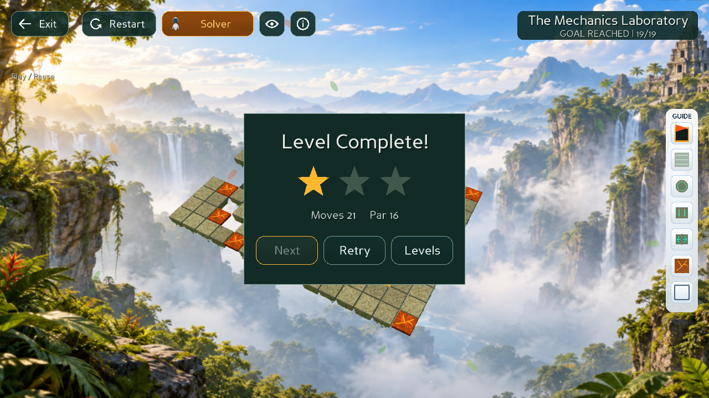
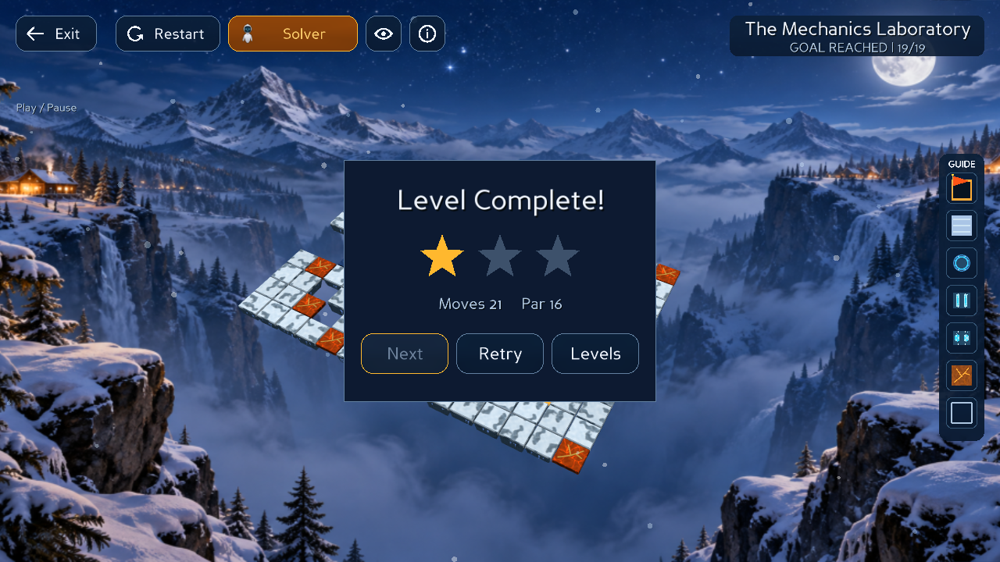

# Bloxorz Solver — Project 1 · CSC14003 / AI

Trò chơi Bloxorz 3D bằng Python/Panda3D, kết hợp chơi tay và sáu thuật toán tìm kiếm: **BFS, DFS, IDS, UCS, Greedy và A\***. Người chơi điều khiển khối đến đích, sử dụng cầu/công tắc và cơ chế tách hai cube; có thể yêu cầu AI giải tiếp từ trạng thái đang chơi.

| Jungle / Light | Snow / Dark |
| --- | --- |
|  |  |

Ảnh chụp runtime thật sau khi replay đến Goal ở Level 19; không phải concept art.

## Mục lục

- [Tính năng](#tính-năng)
- [Cài đặt](#cài-đặt)
- [Chạy chương trình](#chạy-chương-trình)
- [Cách chơi và điều khiển](#cách-chơi-và-điều-khiển)
- [AI Solver và replay](#ai-solver-và-replay)
- [Thuật toán và heuristic](#thuật-toán-và-heuristic)
- [Metrics](#metrics)
- [Kiểm thử](#kiểm-thử)
- [Benchmark](#benchmark)
- [Cấu trúc code](#cấu-trúc-code)
- [Xử lý lỗi thường gặp](#xử-lý-lỗi-thường-gặp)
- [Tài liệu và đóng góp](#tài-liệu-và-đóng-góp)

## Tính năng

- **19 màn chơi JSON**, gồm sandbox cơ chế ở Level 11 và **The Mechanics Laboratory** ở Level 19.
- Chơi bằng bàn phím hoặc chuột; camera Iso / Top / Follow, xoay và zoom.
- Hai theme Jungle/Light và Snow/Dark, sàn tuyết và công tắc có nhận diện theo theme; chất lượng mặc định High.
- Animation lăn, rơi theo cạnh, vỡ ô, cầu/công tắc, hút vào đích và năng lượng teleport khi tách/nhập khối.
- Move Assist dự báo vùng đáp, cảnh báo sát biên/rơi/vỡ; Mechanics Guide giải thích và định vị cơ chế trên board.
- Sáu solver chạy qua worker; phát nghiệm với Play/Pause, Step và tốc độ điều chỉnh được.
- HUD đo tìm kiếm; lưu cài đặt, sao và thành tích theo màn; âm thanh gameplay và nhạc nền.

## Cài đặt

**Yêu cầu:** Python **3.10 trở lên**, khuyến nghị **3.12**; desktop có driver OpenGL để mở Panda3D. Kích thước cửa sổ tối thiểu **1024 × 720**. Không coi hướng dẫn cài đặt là xác nhận đã kiểm thử trên mọi hệ điều hành.

Dependencies trong [requirements.txt](requirements.txt): Panda3D **1.10.16**, NumPy, Pillow và pytest. `direct.*` được cung cấp trong cùng gói Panda3D, không cài riêng.

```bash
git clone https://github.com/hoanghiep06/Bloxorz_Solver.git
cd Bloxorz_Solver
```

**Linux / macOS:**

```bash
python3 -m venv .venv
source .venv/bin/activate
python -m pip install -r requirements.txt
```

**Windows CMD:**

```bat
py -3.12 -m venv .venv
.venv\Scripts\activate.bat
python -m pip install -r requirements.txt
```

**Windows PowerShell**, gọi trực tiếp Python của môi trường để không cần đổi execution policy:

```powershell
py -3.12 -m venv .venv
.\.venv\Scripts\python.exe -m pip install -r requirements.txt
.\.venv\Scripts\python.exe -B main.py
```

Sau khi kích hoạt môi trường, kiểm tra:

```bash
python -m pip check
python -c "from panda3d.core import PandaSystem; print(PandaSystem.getVersionString())"
```

Phiên bản Panda3D phải là `1.10.16`. Quy trình cài mới trước đây đã được kiểm tra trên Linux/Python 3.12.14. Lần kiểm tra merge `0e607d4` dùng Linux/Python 3.14; kết quả chi tiết ở phần kiểm thử.

## Chạy chương trình

Chạy tại thư mục gốc repo, sau khi kích hoạt `.venv`:

```bash
python -B main.py
```

Chọn **Start → chọn level**. Main menu còn có Settings, About và Quit.

- **Level 11:** Advanced Mechanics Sandbox, thuận tiện thử nhanh cơ chế.
- **Level 19:** The Mechanics Laboratory, board 13 × 17, gồm các nhóm cầu, Soft/Heavy/Split, Fragile và Void. Có nhánh thử nghiệm tùy chọn; thắng không bắt buộc đi qua mọi cơ chế. Xem [tọa độ, đường thử và luật của màn](docs/levels/LEVEL_19_MECHANICS_LAB.md).

Các tùy chọn có thật trong CLI:

| Tham số | Ý nghĩa |
| --- | --- |
| `--levels PATH` | Đổi **thư mục** chứa level JSON; không phải số màn cần mở |
| `--save PATH` | Dùng file lưu riêng |
| `--shadows` | Bật tùy chọn shadow khi khởi tạo |
| `--no-aa` | Tắt anti-aliasing |

Ví dụ dùng save riêng để thử game, không ghi tiến độ mặc định:

```bash
python -B main.py --save ./qa-save.json
```

Save mặc định: `~/.bloxorz_solver/save.json` (`~` là thư mục người dùng). Không đưa save thử nghiệm vào commit. CLI hiện không có tham số mở trực tiếp Level 19; chọn màn qua menu.

## Cách chơi và điều khiển

| Thao tác | Điều khiển |
| --- | --- |
| Di chuyển | WASD hoặc các phím mũi tên |
| Chơi bằng chuột | Settings → Mouse; click quanh khối để lăn |
| Đổi cube đang điều khiển | Space, khi đang tách |
| Restart màn | R hoặc nút Restart |
| Play / Pause nghiệm AI | Enter, P hoặc nút Play/Pause |
| Đổi camera Iso / Top / Follow | C hoặc nút camera trên HUD |
| Xoay camera | Giữ chuột trái và kéo ngoài HUD |
| Zoom | Con lăn chuột ngoài HUD |
| Bật/tắt nhạc | M |
| Quay lại | Esc, tùy màn hình hiện tại |

Camera có ánh xạ điều khiển theo hướng nhìn; sau khi xoay, hướng trên màn hình có thể khác action `U/D/L/R` trong dữ liệu Core. Kéo camera và click di chuyển được phân biệt để tránh lăn ngoài ý muốn.

| Cơ chế | Hành vi |
| --- | --- |
| Goal | Khối nguyên đứng thẳng đúng ô đích để thắng |
| Bridge | Cầu active đỡ khối như sàn; inactive không có điểm đỡ |
| Soft Switch | Chạm vào để kích hoạt liên kết cầu |
| Heavy Switch | Chỉ khối nguyên đứng thẳng mới kích hoạt |
| Split Switch | Tách thành hai cube tại các đích Core xác định |
| Fragile | Vỡ khi khối nguyên đứng thẳng; nằm ngang/dọc hoặc cube nhỏ vẫn an toàn |
| Void | Không có sàn đỡ; bước vào có thể rơi |

Hai cube điều khiển riêng, Space đổi cube; khi đạt điều kiện kề cạnh của Core chúng nhập thành một khối.

**Move Assist:** bốn mũi tên báo nước đi an toàn/nguy hiểm/bị chặn; hover hiển thị vùng đáp, viền vàng cảnh báo sát biên. Cảnh báo đỏ **không chặn thao tác**. Hỗ trợ ẩn khi không được điều khiển tay, như animation, replay và tutorial.

**Mechanics Guide:** rail bên phải mở Help Card; click cơ chế có trong màn sẽ định vị và highlight target. Click tiếp để duyệt các target cùng loại; dùng **Back to Board** để trở về. Cơ chế không có trong level chỉ mở thông tin; focus có thể bị từ chối khi gameplay đang bận. Xem [chi tiết Guide](docs/gui/MECHANICS_GUIDE.md).

Settings cho phép chọn Keyboard/Mouse, Light/Dark, Music / Ambience và Sound effects. Không còn chọn chất lượng đồ họa, Master volume hoặc Mute All trên UI; chất lượng cố định High. Bloom phụ thuộc hỗ trợ của backend.

## AI Solver và replay

1. Chơi tay đến vị trí mong muốn hoặc giữ trạng thái đầu màn.
2. Mở **AI Solver**, chọn BFS, DFS, IDS, UCS, Greedy hoặc A*.
3. Dùng Play để phát nghiệm, Pause để dừng, Step để thực hiện từng action; chỉnh tốc độ bằng điều khiển trong panel.
4. Replay đi tiếp từ trạng thái đã giải; không tự quay về Start.

Root tìm kiếm giữ tư thế, bridge flags, hai vị trí cube và active cube. **Moves** giữ các action đã chơi rồi cộng action replay; **Solution Length** chỉ là đoạn nghiệm còn lại. Chọn solver không tự thêm bước chơi.

Nếu không có nghiệm, UI thông báo và giữ trạng thái; đóng thông báo để tiếp tục chơi tay hoặc Restart. Restart/đổi level hủy kết quả cũ để không phát nghiệm của session trước. Xem [contract solve từ current state](docs/integration/SOLVE_FROM_CURRENT_STATE.md).

## Thuật toán và heuristic

| Solver | Mục tiêu và giới hạn |
| --- | --- |
| BFS | Ít action nhất với chi phí mỗi action bằng nhau |
| DFS | Tìm theo chiều sâu, không bảo đảm nghiệm ngắn nhất |
| IDS | Tăng giới hạn độ sâu; tìm nghiệm ít action nếu giới hạn cấu hình đủ để tới nghiệm |
| UCS | Tổng chi phí thấp nhất theo cost model không âm |
| Greedy | Ưu tiên heuristic có trọng số; không bảo đảm tối ưu |
| A* | Ưu tiên `g + h`; mặc định tối ưu cùng mô hình trọng số với UCS, dùng heuristic an toàn hiện tại |

A*/UCS mặc định dùng `TunedWeightCost`: bước hướng 1; phạt đảo chiều 3; nguy cơ Void 2; vào Fragile 4; thay cờ cầu 2,5; vào ô cầu 3. Các khoản phạt được áp dụng theo định nghĩa trong [cost_functions.py](src/solvers/UCS_Algorithm/cost_functions.py), không phải luật cấm đi. Space/Switch có chi phí mô hình 0 nhưng vẫn là action trong Moves/Solution Length.

**Heuristic A*:** màn không có Split dùng chặn dưới khoảng cách có xét tư thế. Màn có Split/teleport dùng `h = 0` cho toàn bộ trạng thái, kể cả trước khi chạm công tắc; trạng thái split cũng dùng 0. Teleport làm khoảng cách không gian có thể vượt chi phí thật. Cách hiện tại giữ tính đúng nhưng giảm lợi thế định hướng, khiến A* có thể duyệt tương tự UCS. Cam kết này áp dụng cho mô hình mặc định; không mặc nhiên áp dụng cho cost function tùy biến có bước rẻ hơn chặn dưới.

**Nhiều bước hơn không đồng nghĩa sai:** từ Initial State ở Level 19, BFS tìm 16 action; A*/UCS mặc định tìm 20 action với cost 38. Đây là hai mục tiêu khác nhau. Chọn `UniformCost` qua API nếu muốn so sánh A* với BFS theo số action; GUI hiện dùng mặc định.

Thông tin tuning: [hướng dẫn Phong](Bloxorz_Weight_Tuning_Guide/README_VI.md), [quyết định merge và kiểm chứng](docs/PHONG_WEIGHTED_MERGE.md). Dữ liệu tuning lịch sử bao phủ Level 01–18; không xem các CSV cũ là phép đo tự động của HEAD hiện tại.

## Metrics

| Chỉ số | Định nghĩa |
| --- | --- |
| Moves | Số action đã thực hiện trong lượt chơi |
| Search Time | Thời gian `_search()`, không gồm phát animation; API trả giây, HUD trình bày theo đơn vị của UI |
| Expanded Nodes | Số lượt xử lý node; không tính phần tử stale bị loại trước khi xử lý |
| Solution Length | Số action trong nghiệm, tính từ root của lần tìm kiếm |
| Peak Python Memory | Đỉnh allocation Python do `tracemalloc` theo dõi, KiB; không phải toàn bộ RAM/RSS của tiến trình |
| Weighted Cost | Tổng chi phí cost model, truy cập qua solver A*/UCS; không phải một ô metrics bổ sung trên HUD |

`penalty`, `score` trong evaluator/benchmark là chỉ số đánh giá trajectory riêng, không đồng nhất với weighted cost của solver. Khi so sánh, cần giữ cùng level, root, cost model và môi trường đo.

## Kiểm thử

Chạy bộ test từ thư mục repo:

```bash
python -B -m unittest discover -s tests
```

Có thể chạy theo module:

```bash
python -B -m unittest discover -s tests -p test_astar.py
python -B -m unittest discover -s tests -p test_level19.py
```

**Mốc đã xác minh: merge `0e607d4` — 663 tests PASS**, Linux/Python 3.14/Panda3D 1.10.16. Đây là kết quả của revision đó, không phải số test cố định cho mọi phiên bản. Xem [log và phạm vi runtime](docs/PHONG_WEIGHTED_MERGE.md).

Kiểm tra tích hợp bằng cửa sổ Panda3D thật và native input trên Linux/X11:

```bash
python -B -m tools.current_state_solver_smoke --output /tmp/bloxorz-current-state
python -B -m tools.phong_merge_smoke --output /tmp/bloxorz-weighted-ui
```

Các smoke tool này cần desktop X11/native input; không phải lệnh UI đa nền tảng. Ví dụ trong môi trường Linux không có display, nếu đã có Xvfb và GLX:

```bash
xvfb-run -a -s '-screen 0 1600x1000x24 +extension GLX' python -B -m tools.phong_merge_smoke --output /tmp/bloxorz-weighted-ui
```

Runtime kiểm tra current-state, sáu solver, replay, bridge/split/active cube và hai theme; tool weighted kiểm tra UCS/A*/Greedy trên Level 19. Có ảnh thật và JSON report; không thay thế việc đánh giá âm thanh qua loa. Xem thêm công cụ trong [STRUCTURE.md](STRUCTURE.md).

## Benchmark

Hai CSV ở thư mục gốc hiện giữ nguyên **bộ thực nghiệm của Huy**, commit `c8c8ab4`, sáu solver trên Level 01–18. Xem [nguồn và phạm vi số liệu](docs/experiments/HUY_BENCHMARK.md); đây không phải kết quả đo lại code main sau merge.

Chạy tất cả file `level_*.json` trong `levels/` với sáu solver:

```bash
python benchmark.py
```

Chạy tập con:

```bash
python benchmark.py --levels 1,11,19 --output benchmark_review.csv --timeout 15
```

- `--levels`: danh sách số màn phân tách bằng dấu phẩy; khác `main.py --levels` vốn nhận thư mục.
- `--output`: CSV chi tiết, mặc định `benchmark_results.csv`.
- `benchmark_summary.csv` luôn được ghi tại thư mục chạy, kể cả khi đổi `--output`; hãy lưu kết quả cũ trước khi chạy.
- Cột gồm trạng thái, `runtime_ms`, `memory_kib`, node, steps, backtracks, void hazards, penalty, score và các tỉ lệ thống kê.
- `subopt_ratio` so số bước với BFS; không đo tối ưu weighted cost. Điểm/penalty baseline từ BFS cũng không chứng minh penalty nhỏ nhất.
- `--timeout` hiện dùng ThreadPoolExecutor: báo timeout không cưỡng chế dừng worker; bước BFS baseline ngoài wrapper timeout. Không coi đây là giới hạn tổng thời gian chắc chắn.
- Một số nhãn in của script vẫn ghi “18 levels”; danh sách thực tế được đọc động. CSV/plot commit sẵn là dữ liệu lịch sử, cần chạy mới để đánh giá revision hiện tại.

## Cấu trúc code

Cây tổng quan dưới đây có chú thích; [STRUCTURE.md](STRUCTURE.md) chứa cây chi tiết của source, nhóm GUI và luồng dữ liệu để tra cứu khi sửa code.

```text
Bloxorz_Solver/
├── main.py                       # Entry point mở ứng dụng
├── requirements.txt              # Dependencies của ứng dụng/test
├── src/
│   ├── core/                     # Luật board, transition, state bất biến
│   │   ├── board.py
│   │   └── state.py
│   ├── solvers/                  # Sáu thuật toán + đo tài nguyên
│   │   ├── base_solver.py        # solve(start_state), SearchResult, metrics
│   │   ├── bfs.py / dfs.py / ids.py
│   │   ├── astar.py / greedy.py
│   │   ├── ucs.py                # Public exports của UCS
│   │   └── UCS_Algorithm/        # UCS implementation và cost functions
│   ├── evaluation/               # Đánh giá trajectory, penalty/score
│   └── gui/                      # Panda3D UI, renderer, camera, VFX, audio
├── levels/                       # Production level_01.json … level_19.json
├── assets/                       # Fonts, texture, shader, background, audio/icon
├── music/                        # Nhạc bổ sung
├── tests/                        # Unit/integration tests và fixtures riêng
├── tools/                        # Native UI smoke, capture, tạo assets
├── benchmark.py                  # Đo sáu solver và xuất CSV
├── generate_trajectories.py       # Sinh dữ liệu trajectory
├── trajectories/                 # Trajectory lịch sử của 18 màn
├── Bloxorz_Weight_Tuning_Guide/   # Thí nghiệm/tài liệu tuning; có snapshot riêng
├── docs/                         # Contracts, hướng dẫn, báo cáo, bằng chứng
├── STRUCTURE.md                  # Bản đồ chi tiết source và luồng xử lý
└── CONTRIBUTING.md               # Quy ước Git và contract viết solver
```

Nguyên tắc: **Core quyết định luật → Controller điều phối → Renderer/Animation thể hiện**. Solver sử dụng Core; Guide/camera không được thay luật để tạo hiệu ứng. Snapshot Core trong bộ tuning không thay thế runtime `src/core`.

## Xử lý lỗi thường gặp

| Hiện tượng | Kiểm tra |
| --- | --- |
| `No module named panda3d` hoặc `direct` | Dùng đúng Python `.venv`, cài lại bằng `python -m pip install -r requirements.txt` |
| Ubuntu/Debian không tạo được venv vì thiếu `ensurepip` | Cài gói venv tương ứng Python, ví dụ `python3.12-venv`, rồi tạo lại môi trường |
| Không mở được cửa sổ / lỗi display | Chạy trong desktop có OpenGL; SSH/headless cần display/Xvfb cấu hình riêng |
| Không tìm thấy level khi benchmark | Chạy lệnh từ thư mục gốc repo |
| A* có nhiều bước hơn BFS | Kiểm tra cost model; mặc định A* tối ưu trọng số, BFS tối ưu số action |
| A* và UCS duyệt gần giống nhau | Màn có Split đang dùng heuristic 0 để bảo vệ tính tối ưu |
| Tiến độ/cài đặt không như mong đợi | Thử `--save` với file mới để tách khỏi save cũ; không xóa tiến độ đang dùng nếu chưa sao lưu |
| Benchmark vượt thời gian yêu cầu | Xem giới hạn ThreadPool timeout ở trên; không phải hard deadline |

## Tài liệu và đóng góp

- [Cấu trúc source chi tiết](STRUCTURE.md) · [Quy trình Git và viết solver](CONTRIBUTING.md)
- [Chỉ mục GUI](docs/gui/README.md) · [Render contracts](docs/gui/RENDER_CONTRACT.md)
- [Mechanics Guide](docs/gui/MECHANICS_GUIDE.md) · [Move Assist / Animation](docs/gui/MOVE_ASSIST_ANIMATION.md)
- [Split VFX](docs/gui/CINEMATIC_SPLIT_TELEPORT.md) · [Merge VFX](docs/gui/CINEMATIC_MERGE_TELEPORT.md)
- [Audio](docs/audio/GAME_AUDIO_SYSTEM.md) · [Nguồn tài nguyên hình ảnh](assets/VISUAL_ATTRIBUTION.md) · [Asset credits](docs/gui/ASSET_CREDITS.md)
- [About / thông tin nhóm](docs/gui/ABOUT_PAGE.md) · [Báo cáo thuật toán và đánh giá](docs/BAO_CAO_TONG_KET_NHOM_2.md)

Xem các tài liệu nguồn/credits trước khi phân phối lại assets; không mặc định toàn bộ tài nguyên có cùng giấy phép.
