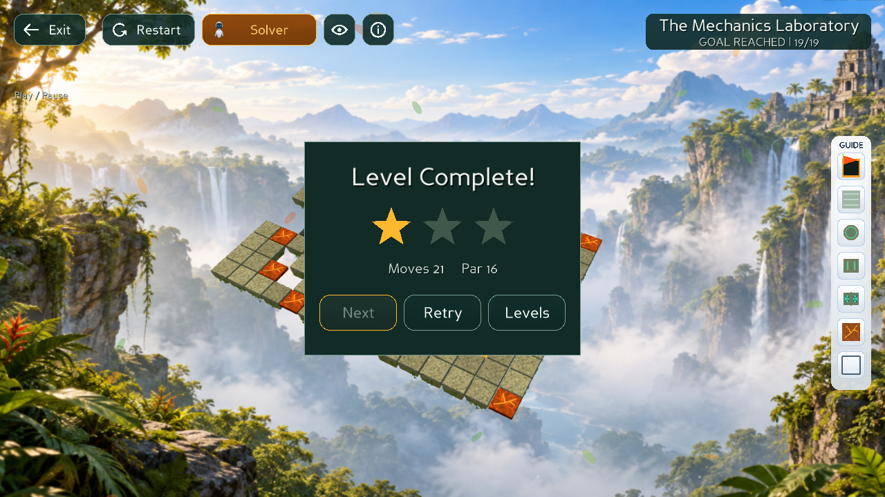
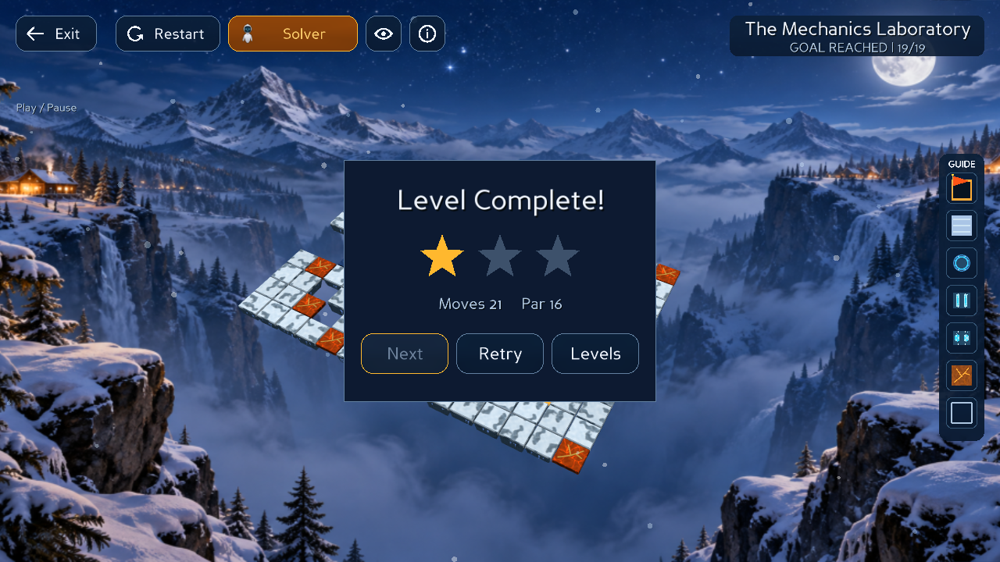

# Phong weighted solver integration

## Merge and resolutions

Merged `refactor/phong/ucs_tuning_w` at `41f3f69` into local `main` at `f2a7340`.
The merge had 19 conflicted files: 17 level JSON files and A*/Greedy initialization.
All 19 production `levels/*.json` are byte-identical to pre-merge main; SHA-256 values are recorded in [preserved-levels.json](evidence/phong-weighted-merge/preserved-levels.json).
Core, GUI, animation, audio, renderer and BaseSolver remain unchanged from main.

- Preserve `get_start_state()` for A*, Greedy and UCS, including bridge flags, cube positions and active cube.
- Receive Phong's tuned cost model, weighted Greedy, history-sensitive `(state, last_action)` search keys and result-field resets.
- Preserve main's A* zero heuristic for any split-capable board and split state. A spatial estimate across teleports can overestimate actual remaining cost. The regression fixture has estimate 13.5 under the incoming spatial formula but a valid four-action path costing 4.
- On other boards retain main's spatial lower bound; default tuned directional step cost is at least one.
- Receive the branch's evaluator, trajectory generation, benchmarks, tuning guide and historical experiment files. The copied Core under the tuning guide is reference/training code, not the runtime `src/core`.

## Cost objective and compatibility

Default A*/UCS optimize tuned weighted cost, not action count. On production Level 19 from the initial state, BFS returns 16 actions; weighted A*/UCS return 20 actions at cost 38. Tests compare weighted A* with UCS and independently replay and score transitions. Unit-cost shortest-action tests explicitly select `UniformCost`.
SPACE/SWITCH has zero model cost but still counts as a gameplay action in Moves and solution length. No metrics pipeline or controller semantics are changed.
Greedy uses Phong's tuned priorities and has no optimality guarantee.

## Validation

- Pre-merge isolated baseline: 659 tests, one existing Settings assertion failure. Main intentionally removed Master volume/Mute All in `e664d05`; the stale test now verifies their absence and retains layout/theme checks. Settings implementation was not changed.
- Final full suite: **663 tests PASS**, 174.117 seconds. Includes incoming Greedy tests and two added weighted A* regressions.
- Focused A* suite: 7 PASS. Focused current-state suite: 16 PASS.
- Native input in real Panda3D GLX windows under Xvfb: all six solvers from a changed bridge/split state with cube 1 active, full replay, manual current poses, Step/Play, continuous Moves, Light/Dark, No Solution preservation and stale-result cancellation pass.
- Production Level 19: manually move Right twice, then use native UI to run UCS/A*/Greedy and replay to Goal in both themes. Each returns 19 remaining actions and 21 total Moves. A*/UCS independently scored cost is 39.5, Greedy 50.5. Start state and session are preserved.
- All 19 level files verified byte-for-byte against `f2a7340`. No unresolved merge entries.

Evidence: [full suite](evidence/phong-weighted-merge/full-suite.log), [baseline](evidence/phong-weighted-merge/baseline.log), [native current-state report](evidence/phong-weighted-merge/native-current-state-report.json), [native production report](evidence/phong-weighted-merge/native-production-report.json).

Actual rendered screenshots, reviewed after capture:

## Limits and historical data

Historical tuning/benchmark CSVs and plots are imported evidence from Phong, not regenerated results for this merged revision. Training data covers levels 01–18; production Level 19 was validated separately. Older Level 19 AI tables describe the previous cost configuration.
The benchmark ThreadPoolExecutor timeout is not a hard process deadline; it remains unchanged. Native runtime checks use null audio and do not validate speakers/audio output. Full-suite missing-background and fake-GSG shader messages are deliberate fallback tests and also occur in the baseline.
Incoming historical files have whitespace warnings under `git diff --cached --check`; they were preserved, rather than reformatted as part of the algorithm merge.
