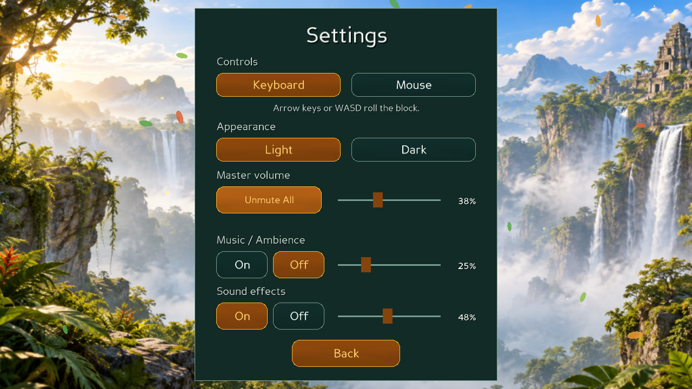
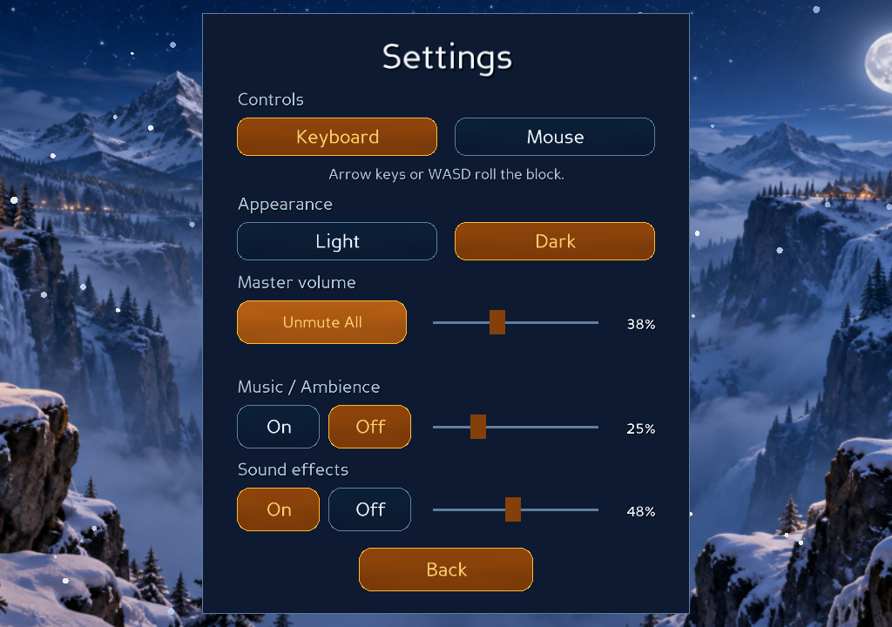

# Cinematic Game Audio System V1

## Architecture and ownership

The existing `src/gui/audio.py::AudioManager` is extended; there is no competing audio framework or new ShowBase. It owns mixing, music playlist, theme ambience, pooled sound instances, scope pause/stop, an audio-only maintenance task, bounded diagnostics and disposal.

- `audio_events.py`: typed `AudioEvent`, `SoundSpec`, immutable cue thresholds, read-only animation cue routing, `AnimationAudioTrack`.
- `sound_bank.py`: preloads three independent Panda `AudioSound` instances per authored WAV. Missing files log a warning and become silent cues. Playback does not load files.
- `AnimationManager`: optional audio injection. After sampling a visual pose, samples the audio track with the **same progress**. No independent gameplay timer. Pause/resume/cancel/resync/dispose forward lifecycle notifications.
- `GameScene`: passes the existing application audio manager to the animation manager.
- `LevelIntro`: drop whoosh at `_begin_drop`, single landing impact at `_land`; skipping the intro never fabricates an impact. Restart/navigation cancels its audio scope.
- `UIFlow`: enables gameplay audio only on the game screen, switches ambience, stops restart/navigation audio, removes the old Controller-driven roll/goal/fall sound dispatch.
- HUD/Guide/Screen buttons: one UI cue at the interaction boundary; opening a Help Card never emits mechanical gameplay sounds.

Audio reads validated Basic/Advanced visual DTOs and existing `FallPlan`/teleport constants. It never calls Core transitions, activates a switch, changes a bridge, determines success, commits a state, increments Moves or touches solver metrics. Audio backend exceptions in cue sampling are isolated from the visual action.

## API

```python
audio.play_sfx(AudioEvent.ROLL_IMPACT, scope=('animation', session_id, request_id))
audio.start_loop(AudioEvent.FALL_WIND, scope=scope)
audio.stop_loop(handle)
audio.set_voice_gain(handle, gain)
audio.pause_gameplay_audio()
audio.resume_gameplay_audio()
audio.stop_session_audio(session_id=None)
audio.set_master_volume(value)
audio.set_sfx_volume(value)
audio.set_music_volume(value)     # shared Music / Ambience slider
audio.set_ambience_volume(value)  # optional independent presentation API
audio.set_muted(value)
audio.set_theme('light')
audio.dispose()
```

`play('click')` compatibility remains for existing menus; new code uses typed events. Diagnostic history is a bounded deque of 512 consumed playback events; counters track accepted/dropped voices and peak concurrent count.

## Event-to-sound and synchronization

| Action | Cue source/timing | Sound |
| --- | --- | --- |
| Opening | Actual intro drop start and contact callbacks | Quiet wind then heavy stone landing; wind stops at contact |
| Roll | Progress 0 scrape; progress 1 actual floor contact | Scrape plus one of three impact variants |
| Split cube roll | Same visual roll contact | Lighter cube impact |
| Roll onto unsupported area / goal aperture | Read-only after-snapshot floor/bridge/broken/goal footprint check | Suppress fictitious floor impact; terminal phase supplies sound |
| Fall | Existing `FallPlan.roll_end` and `tip_end`, divided by request duration | Optional edge scrape only when a real pivot exists, then wind |
| Free fall | Same `FallPlan.sample()` opacity | Wind ramps up and fades with the actor; stops at terminal end, no ground collision sound |
| Goal | Validated `GOAL_COMPLETE` terminal request, progress .35 and 1 | Activation at sink start; one 2.1 s victory flourish at completion |
| Soft/Heavy | Actual `SWITCH_ACTIVATE` visual event and authoritative switch definition | Distinct energy click / pressure clunk |
| Split Switch | Confirmed `SPLIT` event (generic marker activation is silent) | One switch charge before the existing teleport phases |
| Bridge | Actual `BRIDGE_PRESENT` / `BRIDGE_ABSENT` event | Open/close movement; stop with the visible request |
| Fragile | Existing crack request start/end | Crack at start, break at end, then fall wind with terminal request |
| Split | Progress 0/.24/.44/.70/.90 from the existing teleport constants | Charge/disassembly/travel/arrival/materialization |
| Merge | Existing reverse choreography phases 0/.22/.42/.66/.85 | Same energy family in fusion timing |
| UI | One click callback, short rate limit | Tactile click, confirm or back |
| Theme | One ambience owner | Jungle/Snow loop; stop old loop before starting the next |

A single arrival is emitted per split/merge transition, not per cube. Changing the active cube emits no teleport. Visual preview/attract mode stays silent for gameplay effects. No camera, board geometry, block material, rolling/falling math, teleport geometry or level files were changed.

## Crossing thresholds, replay and lifecycle

Each request has a scope `(animation, session_id, request_id)` and a monotonically consumed cue cursor. A large dt consumes all crossed boundaries in order. Repeated or backward samples cannot replay a consumed cue. Finished/cancelled tracks are closed; stale references cannot produce new events.

Playback at .25×/1×/4× changes threshold crossing time through the existing animation timeline. Short SFX keep their natural duration and small deterministic seeded pitch variation (0.97–1.03), rather than shifting the whole soundtrack with replay speed. Wind follows visual opacity. Bridge motion is stopped at the visual endpoint. Important terminal tails may continue after a completed request, but restart, resync, navigation and disposal stop their session scope.

Pause stores each gameplay voice's playback position and stops its source. Resume restarts at that offset without re-dispatching cues. UI sound remains independent. Multi-phase Step uses the unchanged controller action flow and completes one entire Core action. The same cue track handles manual play and all six solver replays.

## Mixing, limits and Settings

`Effective SFX gain = Master × SFX × Event gain × Variation × Dynamic headroom`.

- Master defaults to 80%; SFX and Music/Ambience retain their existing 70% defaults and On/Off switches.
- **Master volume**, **Mute All**, **Music / Ambience**, **Sound effects** share the current Settings style. Sliders show percentages; values are saved in the existing user JSON.
- Mute changes output gain to zero, preserving slider values; it does not replay old gameplay cues on unmute. A skipped ambience loop starts safely when unmuted.
- Legacy saves default the new fields safely. Invalid/out-of-range/bool-as-number volume values are ignored. Other settings and progress are preserved.
- A summed-gain budget of .7, or .5 when music is enabled/wanted, controls overlapping SFX. Music retains its .6 share and ducks to .55 during high-priority landing/energy/victory effects.
- Maximum 16 active SFX/ambience voices. Low-priority UI/ambience may be evicted for important gameplay; equal/higher priority sounds are not indiscriminately cut. Per-file pools bound repeated effects. UI clicks are limited to one per 35 ms.
- One theme ambience loop at a time. These are original designed water/air-like noise beds, not recordings of birds or snow. Music remains the existing playlist/fallback; no new licensed music was downloaded.

## Assets and reproducibility

27 authored 48 kHz stereo PCM WAVs, ~5 MiB total. Original broadband filtered noise, inharmonic stone resonances, friction/grit, wind, energy textures and musical flourish; not single-beep substitutions. Generate offline with:

```bash
.venv/bin/python -B -m tools.build_game_audio
```

See [asset permission and sources](AUDIO_ASSET_LICENSES.md). Existing MP3 licensing was not audited by this audio implementation.

## Testing and runtime evidence

See `evidence/` for the final regression log, machine-readable native runtime report, real framebuffer screenshots and an excerpt of the actual isolated loopback recording. The earlier feature/merge logs are not used as proof for this change.

Automated tests include real visual DTO/Core action pipelines with fake audio backends: bank cache/missing assets, gains/mute, config, independent instances, all roll poses, 30/60/120 FPS and .25×/1×/4× timing, large dt/repeated samples, fall/no fake impacts, actual switch/bridge/fragile/split/merge events, six solvers, goal once/cancelled goal, pause/resume, restart/level change/dispose and audio-device fault isolation.

The native tool uses actual Panda3D GLX GraphicsWindows, OpenAL and X11 XTest. For safe loopback it requires an explicitly named **dedicated QA Pulse null sink**; it never records the user's default monitor:

```bash
pactl load-module module-null-sink sink_name=bloxorz_audio_qa
PULSE_SINK=bloxorz_audio_qa ALSOFT_DRIVERS=pulse LP_NUM_THREADS=2 \
  xvfb-run -a -s '-screen 0 1600x1000x24 +extension GLX' \
  .venv/bin/python -B -m tools.game_audio_smoke \
  --sink bloxorz_audio_qa --output /tmp/bloxorz-game-audio-final
# Afterwards unload the module ID returned by pactl.
```

Native checks cover intro contact, standing/lying rolls, void fall, fragile break, soft/heavy/split switches, bridge state changes, multi-phase split/merge, Goal, six spawned solver replays, Pause/Step, restarting during wind, changing levels during teleport, Light/Dark, two window sizes, native volume/mute interaction and cleanup.

## Kết quả nghiệm thu (2026-10-29)

- Baseline: **605 tests PASS**, giữ nguyên thay đổi UI chưa commit từ trước.
- Bộ mới: **23 test audio chuyên biệt**, gồm cue contact/phase, cache/mix, config, cancellation và lỗi backend. **628 tests toàn dự án PASS**, không failure/error; log cuối trong [regression.txt](evidence/regression.txt).
- Runtime chính: **11 nhóm PASS** trên OpenAL/Pulse thực; 332 cue phát, 0 drop, peak **5/16 voices**, 81 sound instances prewarm, không load thêm trong gameplay. Đóng game: 0 voice, 0 bank asset.
- Bản ghi loopback: 48 kHz stereo, 251.56 giây; peak **10.232 / 32.767**, RMS **738,53** theo đơn vị PCM16; không clipping. [Đoạn nghe thử 18 giây](evidence/audio-preview.wav) cắt từ bản ghi thực tế, không normalize hoặc dựng lại bằng cách ghép asset.
- Cửa sổ mới: khôi phục Master 31%, SFX 44%, Mute; native Unmute mở đúng một ambience; intro/roll cue một lần; dispose giải phóng cả music references và callback maintenance cũ trở thành no-op. Lượt restore-only dùng OpenAL Soft null output; lượt ghi tín hiệu thực dùng dedicated Pulse monitor riêng.
- Frame timing cùng scene/software GL: median **137,65 ms → 138,64 ms** khi bật maintenance + wind (~0,99 ms, ~0,72%). Mix CPU trung bình **2,77 µs**. Đây là mẫu so sánh maintenance tắt/bật cùng engine, không phải benchmark GPU hoặc FPS trên máy người dùng; renderer phần mềm ở High là phần lớn chi phí.
- Đã gỡ Pulse QA sink sau kiểm thử. Không ghi monitor âm thanh mặc định của hệ thống.

[Runtime report](evidence/runtime-report.json) · [Restore report](evidence/restore-report.json) · [Frame timing](evidence/frame-timing.json) · [Asset hashes](evidence/asset-manifest.json)




## Known limits

**AUDIO SUBJECTIVE QUALITY NOT VERIFIED.** Playback can be verified objectively by real OpenAL decoding, PLAYING sources and non-silent unclipped loopback PCM. That is not a claim that the effects were listened to or judged cinematic by a human. Review the included recording and assets on speakers/headphones before final artistic approval.

This is a non-spatial puzzle mix. No HRTF or room reverb is introduced. Platform validation covers Linux OpenAL/Pulse; unavailable audio devices degrade to silence. No new compressed ambience decode dependency is required because the supplied loops are WAV. A missing supplied asset becomes silent with an explicit warning; it is not replaced by a misleading beep.

## Files changed for audio

- `src/gui/audio.py`, `audio_events.py`, `sound_bank.py`.
- `src/gui/animation_manager.py`, `game_scene.py`, `level_intro.py` (minimal audio hooks).
- `src/gui/game_app.py`, `screens.py`, `hud.py`, `mechanics_guide.py`, `profile.py` (wiring/settings/UI cues).
- `assets/audio/sfx/`, `assets/audio/ambience/`.
- `tests/test_game_audio.py`; Settings label assertions in `test_game_ui_state.py` and its native smoke tool updated for the combined Music/Ambience label.
- `tools/build_game_audio.py`, `tools/game_audio_smoke.py`.
- This document and the asset license document.

Uncommitted UI edits from the preceding requests are preserved. No branch switch, commit, push or merge is performed for this task.

## Final status

**CINEMATIC AUDIO SYSTEM V1 COMPLETE** về triển khai, regression và playback được xác minh bằng loopback. **AUDIO SUBJECTIVE QUALITY NOT VERIFIED**: cần người dùng nghe review để duyệt chất âm. Chưa commit/push/merge.


## Elemental switch extension (2026-10-29)

The existing typed Soft/Heavy/Split cues now select optional Snow skins through `THEME_SOUND_FILES`: `soft_switch_ice`, `heavy_switch_ice`, `split_switch_ice`. These are prewarmed by the same SoundBank, preserve cue IDs/scopes/gain/voice limits and fall back to the original sound if an optional skin is absent. Jungle keeps its existing assets. The current bank has 30 authored WAVs / 90 prewarmed instances; older evidence above records the original 27 / 81 bank at that time.

Split Switch sound is emitted by confirmed `SPLIT`, not a generic activated marker, so it cannot replay just from marker appearance. No new audio clock/task/subsystem was introduced. See [Dual-theme Switch VFX](../gui/DUAL_THEME_SWITCH_VFX.md) for current tests and real native-window evidence. The switch runtime used OpenAL Soft null output (decoding/cue checks, not a speaker listening test).
