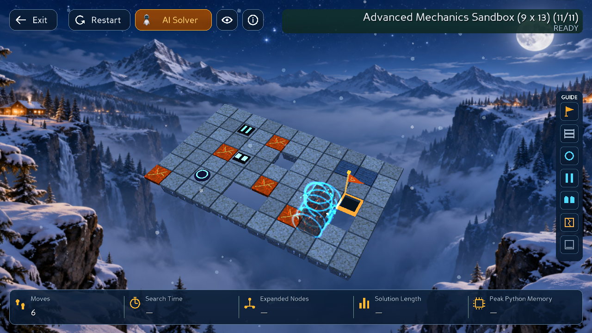

# Cinematic Merge Teleport

Nhập hai cube sử dụng cùng ngôn ngữ hình ảnh với [split teleport](CINEMATIC_SPLIT_TELEPORT.md): **nạp cyan tại hai cube → phân rã năng lượng → hai luồng hội tụ → tái tạo khối magma → vòng năng lượng tan dần**.

Mặc định **1,45 giây ở 1×**, sau pha lăn đưa hai cube đến vị trí nhập Core đã xác định. Giữ nguyên luật kề cạnh, orientation ngang/dọc, bridge flags, cube IDs trước nhập và cách commit Moves. Không tự kéo cube từ xa lại gần hoặc thay đổi Core để kích hoạt nhập.

## Implementation

- `src/gui/split_teleport_math.py`: thêm `MergeTeleportPlan` và `MERGE_TELEPORT_DURATION`. Dùng lại choreography của split bằng đồng hồ thị giác đảo chiều có phân bổ nhịp mới: charge 0–22%, dissolve 22–42%, converge 42–66%, reconstruct 66–85%, settle 85–100%.
- Plan nhận đúng hai source poses và whole target pose từ request đã validate. Cube đặc giữ nguyên vị trí nguồn trong lúc charge/dissolve; chỉ chuyển biểu diễn khi hoàn toàn vô hình. Target cuối là chính xác pose/quaternion Core-to-render cung cấp.
- `src/gui/animation_manager.py`: event `MERGE` cấu hình và sample cùng pool `SplitTeleportVFX` đang có. Cả split và merge chia sẻ geometry, rings, particles, hai đường năng lượng và cơ chế cleanup. Không thêm task, shader, asset hay dependency.
- `src/gui/action_plan.py`: duration merge `.3` → `1.45` giây. Dùng timeline/rate hiện có; không thay đổi sự kiện gameplay, path của solver hay metrics.

Trong animation, state/Moves vẫn là committed state trước action. Sau toàn bộ roll + merge + các pha khác mới commit đúng một lần. Whole cuối có alpha/scale 1; không còn indicator của cube riêng. Cancel/resync phục hồi hai cube trước effect; Restart/đổi level/thoát dọn VFX và callback cũ.

## Kiểm thử

- **569 tests PASS**, 108,639 s; gồm toàn bộ regression của split, current-state solvers và gameplay hiện hữu.
- Thêm 9 test trong `tests/test_merge_teleport.py`: hai tư thế; các nhịp; không có cube đặc bay xuyên map; clock đảo chiều liên tục; Pause/cancel/resync/dispose tại năm nhịp; 30/60/120 FPS × 0,25×/1×/4×; event window và 20 vòng dùng lại pool không tăng nodes/tasks; chung pool split/merge; commit một lần; Restart/đổi level giữa hội tụ.
- Không thay test cũ để che lỗi.

```bash
.venv/bin/python -B -m unittest discover -s tests
.venv/bin/python -B -m unittest discover -s tests -p test_merge_teleport.py
```

## Runtime thật

Game Panda3D thật trong GLX GraphicsWindow/Xvfb, XTest gửi phím và click DirectGUI. Dùng catalog fixtures đã có, không sửa level sản phẩm.

- Sandbox màn 11, Right → Right để split. Từ active cube 0:
  - `D D D D R` tạo whole **HORIZONTAL** tại `(6,8)`.
  - `D D D R R` tạo whole **VERTICAL** tại `(5,9)`.
- Chụp cả năm nhịp và whole cuối trên hai theme. Kiểm tra Core chỉ commit Moves 6 → 7 khi effect kết thúc; whole sau đó tiếp tục lăn được.
- Replay BFS trên fixture màn 5: Pause giữa merge đóng băng toàn bộ VFX; Step hoàn tất action nhập ở Moves 4 và dừng; Play tiếp tục đạt Goal ở Moves 5.
- Restart và đổi level giữa hội tụ dọn effect và không nhận commit cũ.
- Iso/Top/Follow, resize và các rate 0,25×/1×/4× giữ đúng trạng thái whole cuối. Chỉ một GraphicsWindow; không thêm VFX task.

```bash
xvfb-run -a -s '-screen 0 1920x1200x24 +extension GLX' \
  .venv/bin/python -B -m tools.merge_teleport_smoke \
  --output /tmp/merge-teleport-ui
```

[Report](evidence/merge-teleport/report.json) · [Regression log](evidence/merge-teleport/regression.txt) · [Clip thật 0,65×](evidence/merge-teleport/merge-0_65x.gif).



## Tự xem

```bash
.venv/bin/python -B -m src.gui.game_app --levels tests/fixtures/mechanics
```

Chọn **màn 5**: `Right, Right, Space, Right` — bước Right cuối kích hoạt nhập, chờ từng animation xong trước khi bấm bước tiếp. Hoặc BFS → Play để xem đủ split và merge. Màn 11 có thể dùng các chuỗi hướng ở trên.

Clip lấy frame trực tiếp trong runtime ở tốc độ 0,65× để dễ quan sát; thời gian GIF là xấp xỉ, không phải benchmark FPS. Glow vẫn là geometry additive theo phong cách split, không thêm mô phỏng vật lý hoặc camera shake.

Các thay đổi About, Solve From Current State và Split đã có sẵn được bảo toàn. Chưa commit/push/merge.
