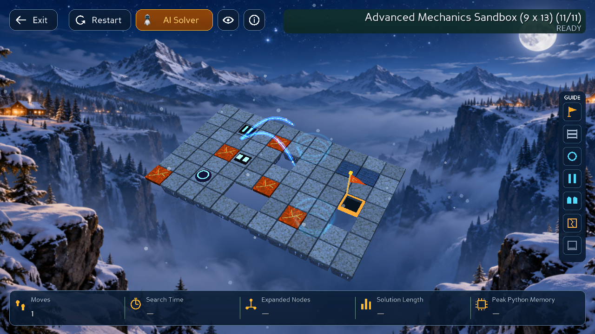
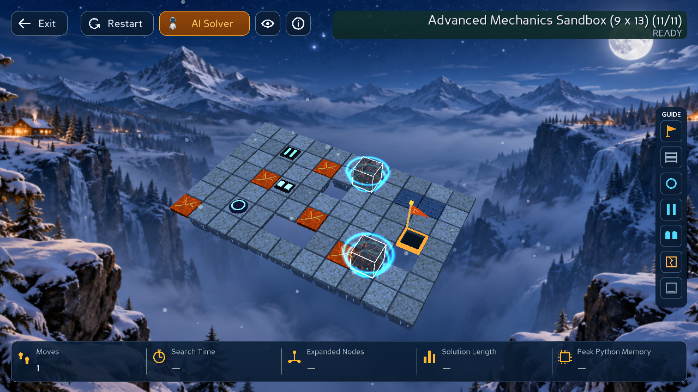

# Cinematic Split Teleport

Nâng cấp split switch thành hiệu ứng teleport cyan/electric blue trong game Panda3D. Không sửa luật Core, ID/vị trí cube, solver, metrics, materials/background hoặc level sản phẩm. Bảo toàn các thay đổi About Page và Solve From Current State chưa commit có sẵn trước task này.

## Choreography

Tổng effect mặc định **1,65 giây ở 1×**, sau pha lăn lên switch. Cùng timeline/rate với các animation hiện hữu.

| Nhịp | Thời gian 1× | Hiển thị |
| --- | --- | --- |
| Whole → Charge | 0–0,396 s | Khối magma giữ nguyên; vòng cyan đi lên, hai vòng nghiêng, scan bands quấn quanh khối |
| Energy disassembly | 0,396–0,726 s | Hai nửa tách nhẹ tại nguồn, tan vào lattice và 28 mảnh năng lượng 3D |
| Dual streams | 0,726–1,155 s | Hai đường năng lượng cong trên cao, lõi cyan, quầng electric blue, đầu sáng và hạt chạy tới đích |
| Materialize | 1,155–1,485 s | Hai receiver rings, khung năng lượng hình cube, hạt tụ và mesh magma tái tạo tại đúng hai đích |
| Active highlight | 1,485–1,650 s | VFX giảm dần; indicator hiện có của active cube chuyển lên rõ ràng |

Các lớp VFX overlap trong khoảng chuyển pha; không chớp toàn màn hình, rung camera hoặc đổi màu magma thành xanh. Chỉ hạt/luồng năng lượng di chuyển giữa nguồn–đích. Cube đặc biến mất hoàn toàn trước khi thay vị trí và chỉ hiện lại tại đích Core cung cấp.

## Ownership / tích hợp

- `src/gui/split_teleport_math.py`: `SplitTeleportPlan` thuần Python. Nhận source/target poses và cube IDs của request đã validate, tạo pose/alpha/scale/active weight theo normalized elapsed time. Không truy vấn Board hoặc tự tính ô teleport.
- `src/gui/split_teleport_vfx.py`: `SplitTeleportVFX`, các mesh procedural dùng chung (annulus có falloff, tube, shard octahedron), pool cố định gồm vòng, hai luồng 24 đoạn, khung cube và 72 hạt. Màn khai báo split switch prewarm pool; request split thuần visual khác có fallback tạo pool lần đầu. Không tạo geometry/NodePath mỗi frame.
- `src/gui/animation_manager.py`: tạo plan và cấu hình pool khi nhận event `SPLIT`; sample cùng timeline với rig/surface; release khi hoàn tất, rollback, cancel/resync và dispose. Không thêm updater task, interval hoặc clock riêng.
- `src/gui/action_plan.py`: thay duration split `.4` bằng `SPLIT_TELEPORT_DURATION=1.65`. Không đổi pha Core hay số moves.

Nguồn dữ liệu: `plan_action()` lấy transition của Core → `AnimationRequest` với đúng target poses/IDs → effect thể hiện request. Trong effect, authoritative state/Moves vẫn giữ ở committed state trước action. Controller commit đúng một lần sau tất cả các pha.

Glow dùng additive geometry có soft falloff, depth test bật, depth write tắt cho VFX, không đổ bóng. Không phụ thuộc shader/bloom, GPU HDR, texture tải ngoài hoặc dependency mới. Hoạt động cả quality low/balanced/high và Light/Dark; không thay shader bloom ấm hiện tại.

## Pause / replay / cleanup

- Toàn bộ chuyển động là hàm của progress; không dùng random hoặc tích lũy vị trí theo frame.
- Pause giữ cả actor, hạt, scan rings và luồng điện.
- Step hoàn tất cả roll + split/effect của một action rồi mới dừng.
- Replay rate 0,25×/1×/4× dùng `AnimationTimeline` đang có.
- Cancel/resync trả pose trước split, full alpha/scale; root VFX ẩn ngay.
- Restart/đổi level/thoát dùng lifecycle manager hiện có để dọn effect và vô hiệu callback cũ.
- Mỗi manager chỉ có một pool; repeated activation không tăng NodePaths/tasks/windows.

## Kiểm thử

Baseline ngay trước task: **547 tests PASS**, 79,633 s.

```bash
.venv/bin/python -B -m unittest discover -s tests
.venv/bin/python -B -m unittest discover -s tests -p test_split_teleport.py
```

`tests/test_split_teleport.py` bổ sung 13 test: nhịp choreography; nguồn ngang và thứ tự cube; đích năng lượng; không có actor bay xuyên map; Pause; 30/60/120 FPS × ba tốc độ; cancel/resync tại năm nhịp; 30 lần dùng lại pool; dispose giữa effect; event timing window; Core/Moves chỉ commit một lần; Restart/đổi level giữa transit.

`tests/test_mechanical_animation.py` điều chỉnh test teleport để công nhận nhịp giữ whole khi charge và hai nửa tách tối đa 0,1 cell tại nguồn. Kiểm tra không bay qua map và không hiện actor lúc đổi vị trí vẫn được giữ; test resource budget trước/sau cancel giữ nguyên, pool được prewarm để đáp ứng invariant này.

**Kết quả cuối: 560 tests PASS**, 106,842 s. Runtime thật PASS. [Report](evidence/split-teleport/report.json) · [Regression log](evidence/split-teleport/regression.txt) · [Clip 0,65×](evidence/split-teleport/teleport-0_65x.gif).





## Runtime thật

Chạy game thật trong GLX GraphicsWindow dưới Xvfb; XTest gửi phím Right/Space và click các nút DirectGUI thật. Không dùng ảnh mock hoặc concept art. Dùng catalog mechanics fixtures có sẵn, không sửa map sản phẩm.

```bash
xvfb-run -a -s '-screen 0 1920x1200x24 +extension GLX' \
  .venv/bin/python -B -m tools.split_teleport_smoke \
  --output /tmp/split-teleport-ui
```

Runtime kiểm tra hai theme trên sandbox 9×13: Right → Right kích hoạt split; state và Moves chưa commit trong effect; cube tái tạo tại `(2,7)` và `(6,9)`; Space đổi active cube rồi Right chỉ di chuyển cube thứ hai. Lưu ảnh năm nhịp và frame clip trực tiếp từ framebuffer trong lúc chạy.

Replay Pause/Step dùng fixture `level_05_split` buộc đi qua switch. Sandbox có đường BFS tránh split nên không dùng nó để khẳng định solver replay đã phát event split. Native QA còn kiểm tra Restart/đổi level giữa transit và Iso/Top/Follow, resize 1280×720 → 1100×760, các rate 0,25×/1×/4×. Với Follow, đường stream nằm trong tọa độ thế giới và có thể ra ngoài khung zoom hiện hữu; không thay policy camera.

## Tự xem trong game

```bash
.venv/bin/python -B -m src.gui.game_app --levels tests/fixtures/mechanics
```

Start → chọn màn **11 — Advanced Mechanics Sandbox** → nhấn **Right hai lần**, chờ mỗi bước hoàn tất. Sau teleport, **Space** đổi cube. Hoặc chọn màn 5 rồi BFS → Play để xem trong replay.

Giới hạn: đây là VFX cách điệu bằng geometry additive, không mô phỏng plasma vật lý/volumetric lighting. Không có camera shake hoặc âm thanh mới. Clip lưu theo frame lấy mẫu để review hình ảnh, không phải benchmark FPS phần cứng.

Không tự commit, push hoặc merge.
