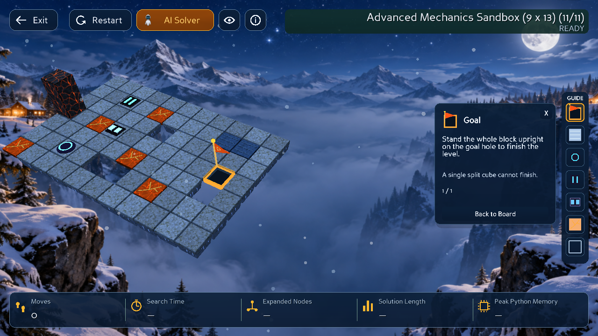

# Mechanics Guide — visual sync và định vị ô

Guide Rail gồm 7 icon khớp visual trong game. Click icon mở Help Card và, nếu có target hợp lệ trong level hiện tại, camera pan/zoom nhẹ đến target. Click lại cùng icon duyệt target tiếp theo; **X** đóng card, **Back to Board** trả camera về trước khi bắt đầu focus.

Rail **58 px**, nút **40×40**, bước **48 px**, card **260 px**. Vị trí rail, font, spacing, màu panel/border và HUD giữ nguyên. Card là overlay bên trái rail; không đổi viewport khi mở, cycling hoặc focus. Nội dung giải thích và ghi chú cũ được giữ nguyên; chỉ bổ sung locator status và Back to Board.

## 1. Icon và nguồn visual

`mechanics_icons.py` dựng icon từ palette/visual spec của mesh. Riêng Fragile dùng lại `assets/materials/fragile.png` để giữ đúng vân đá cam và vết nứt sáng của ô thật, thay nền cam phẳng trước đây. Texture RGB được cache một lần cho cả hai theme; bỏ alpha vì alpha của material là emission mask, không phải độ trong suốt. Geometry cache tối đa 14 bản (7 loại × 2 theme), mỗi instance có wrapper transform riêng để icon trong card không làm rail dịch vị trí. Không thêm asset, render-to-texture, cửa sổ hoặc render mỗi frame.

| Cơ chế | Icon hiện tại | Nguồn đối chiếu |
| --- | --- | --- |
| Goal | Cờ cam, cột vàng và khung hố màu cam | `advanced_mesh_factory.make_flag_mesh`, `FLAG_CLOTH/POLE/GOLD`; `mesh_factory.GOAL_THEME_COLORS` |
| Bridge | Platform với ba thanh nối | `make_bridge_mesh`, ba rib ở −.28/0/.28 và `PALETTES.BRIDGE_*` |
| Soft Switch | Vòng đá rune emerald / vòng sapphire phủ sương trên đế tối | `elemental_switches.switch_parts` và `switch_icon_polygons`, vòng .33/.245, socket .405 |
| Heavy Switch | Hai thanh áp lực đồng/đá hoặc băng, rãnh năng lượng | Shared `BAR_CENTRES` x ±.18, .15×.56 |
| Split Switch | Hai tinh thể riêng biệt, emerald tám cạnh / sapphire sáu cạnh | Shared `CRYSTAL_CENTRES` x ±.20, `crystal_outline(theme)` |
| Fragile | Đá cam có vân và mạng nứt sáng, thêm bốn nhánh nứt nổi | `assets/materials/fragile.png`, `make_fragile_mesh`, endpoint crack và `PALETTES.FRAGILE_EDGE/CRACK` |
| Void | Khung khoảng trống, tâm không có mặt sàn | Advanced/Basic tile kind `VOID` |

Không dùng tint đơn sắc trên toàn icon: cờ và khung, đế tối và glyph cyan vẫn phân biệt. Goal/Bridge/Fragile/Void giữ contour cũ. Ba switch giữ cùng nhận dạng vòng/hai thanh/hai tinh thể; chi tiết và nét cắt đổi theo mô hình Ancient Emerald/Frozen Sapphire thực tế. Icon biểu diễn trạng thái idle canonical, không giả lập trạng thái activated của switch. Ba icon switch được chiếu trực tiếp từ các triangle mặt trên của mesh theo theme, thay glyph giản lược cũ: đầy đủ rune/rêu/đồng ở Jungle và frost/vết nứt/tinh thể băng ở Snow. Hình học được cache tối đa 6 bản, không render-to-texture và không tính mỗi frame. Canvas trong suốt cố định giữ bounding box UI bằng nhau dù mesh có chi tiết viền khác nhau; không dựng thêm mặt sàn trong scene. Viền chọn/hover của switch dùng emerald Jungle hoặc cyan Snow từ cùng palette nguồn.

## 2. Lookup target

`mechanics_focus.mechanic_targets(board_data, mechanic_id)` đọc immutable Basic/Advanced Board Contracts của Controller hiện tại. Không đọc pixel, vị trí actor hoặc gọi Core transition/solver.

- Goal: `goal_cells`.
- Bridge: `bridges`, giữ đúng `bridge_id` và toàn bộ cells của cùng một definition.
- Soft/Heavy/Split: `switches`, phân biệt bằng `SwitchVisualKind`.
- Fragile: các cell được adapter xác định là `FRAGILE`, gồm metadata mà adapter đã ánh xạ vào tiles.
- Void: chỉ các cell `VOID` trong ma trận board; không suy từ platform absent và không chọn ngoài bounds.

Một bridge nhiều cell là một target; chọn cell thực gần centroid nhất, tie-break row-major. Highlight có thể bao quanh tất cả cells của bridge đó, không thêm mặt đỡ.

World position dùng `geometry_math.cell_to_world(row, col, rows, cols, pitch=1)` đang có; focus plane Z=.06 để nhận diện mặt ô. Không hardcode tọa độ level trong implementation.

## 3. Camera focus API

`MechanicsFocus` sở hữu lookup/cycling, camera lease, timeline và highlight. `MechanicsGuide` vẫn sở hữu widget, icon, Help Card và theme.

API chính:

```python
mechanic_targets(board_data, mechanic_id)  # tuple[FocusTarget, ...]
focus.select(mechanic_id)
focus.restore()                         # smooth Back to Board / X
focus.reset(restore=False)              # level/navigation lifecycle
focus.advance(elapsed_seconds)          # deterministic elapsed-time sampling
focus.dispose()
```

`BoardCameraController.capture_presentation()` lưu actual position/quaternion, lens FOV/near/far, config và CameraFit. `apply_presentation()` sample view mà không refit light/background hoặc sửa viewport. Hook `on_user_view_change` nhường quyền khi controller refit/change view/resize. `CameraViewController.acquire_presentation/release_presentation` tạm ngưng Follow và easing zoom đã chờ khi Guide sở hữu view. Input kéo chuột hoặc cuộn mới vẫn được nhận để nhường quyền ngay cho người chơi.

Pan/zoom dùng **0,55 giây**, cubic ease-in-out. Giữ quaternion thực tế, giảm distance tối đa 14%, có giới hạn tránh zoom quá gần. Target được chiếu vào tâm vùng an toàn bên trái card và rail, dưới header và trên metrics. Nếu result dialog hiện, chọn vùng trống bên trái dialog. Không đổi kích thước rail/HUD.

## 4. Duyệt nhiều target

Targets sắp xếp theo representative cell row-major rồi ID. Mỗi mechanic có index độc lập. Click lần đầu chọn index 0; click tiếp chuyển tiếp và quay vòng. Card hiển thị `2 / 5` ở dòng locator thay vì làm tiêu đề dài/tràn.

Đổi level hoặc Restart reset index, đóng card và dọn target/highlight cũ. Context dùng identity Board DTO và session ID đang có; không tạo ID gameplay mới.

## 5. Khôi phục camera và quyền điều khiển

Ảnh chụp camera chỉ lấy ở lần focus đầu tiên; cycling không ghi đè ảnh chụp gốc. Back to Board và X trả về ảnh chụp đó bằng animation 0,55 giây, gồm pose thực tế, góc đã xoay và lens/framing. Không ép về Iso mặc định. Đã test góc 137° và Follow.

- Người dùng đổi view bằng C/nút camera hoặc controller configure: hủy lease và giữ camera do người dùng chọn; không áp callback return cũ. Reframe tự động của Follow không được xem là input người dùng.
- Kéo chuột/cuộn zoom trong khi focus: hủy lease và tiếp tục từ tâm/độ phóng của view đang hiển thị, tránh nhảy về tâm board. Follow tạm ngưng sau thao tác này; C/nút Reset view trả về view hiện tại rồi tiếp tục Follow.
- Back/X khôi phục chính xác view đã xoay/zoom trước khi mở Guide; giữ far plane của team-code để background không bị cắt khi zoom.
- Direct `setPos/setHpr` hoặc lens input cũng được phát hiện bằng so sánh camera với sample gần nhất; Guide không ghi đè ở frame tiếp theo.
- Resize/new level refit camera: hủy lease trước fit mới; không áp lại FOV/aspect của cửa sổ cũ.
- Gameplay bắt đầu trong lúc Guide đang focus: dọn highlight và trả view gốc ngay để nhường quyền, không hủy animation gameplay. Back/X bình thường vẫn dùng animation mượt.
- Restart cùng board phục hồi view gốc và xóa context; đổi board/thoát để hệ navigation/framing hiện tại quyết định camera mới.

Một task locator duy nhất thuộc UIFlow; không thêm task mỗi click. Dispose tháo hook/lease, xóa highlight và task sở hữu.

## 6. Không tồn tại, inactive và broken

- Không có mechanic: card vẫn mở với **Not present in this level**. Không di chuyển camera hoặc tạo marker. Nếu trước đó đang focus nơi khác, giữ view hiện tại và vẫn cho Back to Board.
- Bridge absent: vẫn focus definition, hiển thị **Currently inactive**, chỉ outline; không dựng platform hoặc sửa bridge flag.
- Fragile broken: đọc `broken_fragile_cells` của snapshot render hiện tại và hiển thị **Currently broken**; không phục hồi tile. Có regression tái hiện fragile failure thật rồi click Guide trong `FELL`.
- Intro/tutorial, Rolling/Falling/Split/Merge, search hoặc solver replay: vẫn mở card, từ chối focus với **Focus unavailable during animation or replay.** Không lấy pose actor trung gian.

Highlight là line outline 3D trong `effects_root`, pulse/fade **1,1 giây**; depth test giữ nguyên, depth write tắt, không cast shadow, không material/collision/floor mesh. Hết thời gian, Back, user camera input, Restart, đổi level hoặc dispose đều xóa node.

## 7. Light/Dark và layout

Hai theme giữ cùng semantic visual; ba switch dùng nét cắt và palette chung nguồn với mô hình 3D (xem [Dual-theme Switch VFX](DUAL_THEME_SWITCH_VFX.md)). Màu lấy từ palette mesh đang có, panel/text tiếp tục dùng theme tokens hiện tại; font medium/semibold và alpha chữ 1 không đổi. Không sửa 3D meshes, materials hoặc background themes.

Mỗi icon instance có transform riêng dù geometry dùng cache. Hover/pressed/selected không thay transform/frameSize. Card thay chiều cao theo nội dung thêm nhưng rail/reserved width không thay. Vùng click guard vẫn bao phủ body/padding/card/rail; click locator không thành manual move trên board.

## 8. Files thay đổi trong task này

- `src/gui/mechanics_icons.py` — icon specification và geometry cache.
- `src/gui/mechanics_focus.py` — lookup, cycling, camera ownership/interpolation, highlight/lifecycle.
- `src/gui/mechanics_guide.py` — sử dụng icon nhiều màu; locator text, Back button và callback focus.
- `src/gui/camera.py` — capture/apply presentation và hook trước refit.
- `src/gui/camera_views.py` — lease cho Follow camera.
- `src/gui/screens.py` — tạo helper, safe area và wiring tối thiểu cho Restart/level/navigation/dispose.
- `tests/test_mechanics_focus.py` — lookup/ownership/gameplay tests.
- `tests/test_mechanics_guide.py` — kiểm tra palette vertex colour thay kỳ vọng tint đơn sắc cũ; giữ nguyên các kiểm tra rail position/bounds.
- `tools/mechanics_focus_smoke.py` — native runtime QA.

Không sửa Core, Solver, Controller gameplay, animation math, Split/Merge Teleport, level files, 3D tile meshes hoặc materials trong task này. Các thay đổi chưa commit trước task, gồm About, current-state solving và teleport, được bảo toàn.

## 9. Tests

Baseline liên quan trước sửa: **12 Guide tests PASS**, **12 camera tests PASS**; full suite trước task là 569 PASS.

Test mới gồm: 7 target kinds; Basic/Advanced data; bounds của Void; bridge nhiều cell và inactive; fragile broken thật; multicolour icon spec; clone transform độc lập; safe projection; Back/X khôi phục đúng view; cycling/reset; absent/busy feedback; camera input takeover; Follow; midpoint/endpoint tại 30/60/120 FPS; task budget; không mutate state/Moves; sáu solver; highlight cleanup; rail cố định qua theme/click và dispose.

```bash
.venv/bin/python -B -m unittest discover -s tests
.venv/bin/python -B -m unittest discover -s tests -p test_mechanics_focus.py
.venv/bin/python -B -m unittest discover -s tests -p test_mechanics_guide.py
```

**Kết quả cuối: 586 tests PASS**, 160,465 s (chạy cùng native UI QA); 17 test mới tập trung và 11 nhóm runtime PASS. Log: [report.json](evidence/mechanics-focus/report.json), [regression](evidence/mechanics-focus/regression.txt).

## 10. Runtime screenshots / clip

Chạy game Panda3D thật trong GLX GraphicsWindow dưới Xvfb. XTest gửi click/phím thật tới DirectGUI/MouseWatcher. Screenshot và các frame pan/zoom lấy từ framebuffer, không có mock screenshot.

```bash
xvfb-run -a -s '-screen 0 2200x1400x24 +extension GLX' \
  .venv/bin/python -B -m tools.mechanics_focus_smoke \
  --output /tmp/mechanics-focus-ui
```

Matrix gồm sandbox nhiều cơ chế ở cả Light/Dark; floor/Goal-only và absent Split; Bridge absent/present; Fragile và level không Split; Back/X; góc camera tùy chỉnh/C takeover; click giữa live roll; Restart/đổi level; 1024×720, 1280×720, 1366×768, 1920×1080; cả sáu solver chạy bằng worker thật đến Goal với Moves giữ đúng.

Ảnh trước/sau focus và clip được lưu tại [evidence/mechanics-focus](evidence/mechanics-focus/).

- [Light trước focus](evidence/mechanics-focus/light-before-focus.png) · [Light focus Goal](evidence/mechanics-focus/light-goal-focused.png).
- [Dark trước focus](evidence/mechanics-focus/dark-before-focus.png) · [Dark focus Goal](evidence/mechanics-focus/dark-goal-focused.png).
- [Bridge absent: chỉ outline](evidence/mechanics-focus/inactive-bridge-outline-only.png) · [Không có Split](evidence/mechanics-focus/absent-split-information-only.png).
- [Clip pan/zoom và Back](evidence/mechanics-focus/focus-and-back.gif).



 Chạy bình thường bằng:

```bash
.venv/bin/python -B -m src.gui.game_app
# Catalog mechanics để kiểm tra riêng:
.venv/bin/python -B -m src.gui.game_app --levels tests/fixtures/mechanics
```

## 11. Giới hạn và policy

- Focus bị từ chối khi gameplay busy; không queue tự động. Người chơi click lại khi action/replay hoàn tất.
- Đây là zoom nhẹ và pan định vị; ở target sát mép, một phần board có thể ra ngoài viewport, vẫn giữ ngữ cảnh quanh target. Back khôi phục view trước đó.
- Resize hủy focus và để camera framing hiện tại refit theo kích thước mới; không giữ camera lease cũ.
- Guide giữ orientation/quaternion hiện có; không bổ sung hệ điều khiển orbit mới. Raw camera changes được phát hiện ở update kế tiếp.
- Dưới kích thước tối thiểu 1024×720, Guide ẩn theo layout fallback hiện tại.
- Runtime matrix dùng fixtures và các đường chơi cụ thể, không khẳng định duyệt hết mọi trạng thái của mọi level. Clip lấy mẫu frame, không phải benchmark FPS.

Không commit, push, merge, reset, clean, stash hoặc chuyển branch.


## Follow-up: icon theo theme (2026-10-29)

Soft/Heavy/Split trong cả Rail và Help Card dùng trực tiếp các mặt top/bevel/facet của mesh thật (`switch_icon_polygons`), xếp theo độ cao để giữ đúng socket/rune/latch/frost/gem. Màu lấy từ vertex palette gốc, không tint lại một glyph chung. Goal/Bridge/Fragile/Void giữ nguyên nhận dạng và palette theo theme hiện tại; đặc biệt Fragile vẫn dùng texture đá nứt thật.

Không đổi layout, Help text, focus/cycling, Back to Board hoặc gameplay. **646 tests PASS** (110.589 s), gồm 13 Guide, 20 focus và 16 elemental tests. Hai kiểm tra mới xác nhận các điểm icon thực sự thuộc mesh gốc cùng chi tiết moss/frost và viền chọn dùng đúng năng lượng theo theme. Native GLX/XTest đã click từng switch ở hai theme, so Rail/card với geometry cache theo theme, kiểm tra focus/Back, 20 lần đổi theme khi card mở, bounds/node/task ổn định, State/Moves/revision không đổi và resize 1024/1280.

- [Jungle thực tế](evidence/guide-theme-icons/light.png) · [Snow thực tế](evidence/guide-theme-icons/dark.png).
- [Runtime](evidence/guide-theme-icons/runtime-report.json) · [Regression](evidence/guide-theme-icons/regression.txt).

Lệnh native kiểm tra riêng: `ALSOFT_DRIVERS=null LP_NUM_THREADS=2 xvfb-run -a .venv/bin/python -B -m tools.elemental_switch_smoke --guide-only --output /tmp/bloxorz-themed-guide-ui`.
