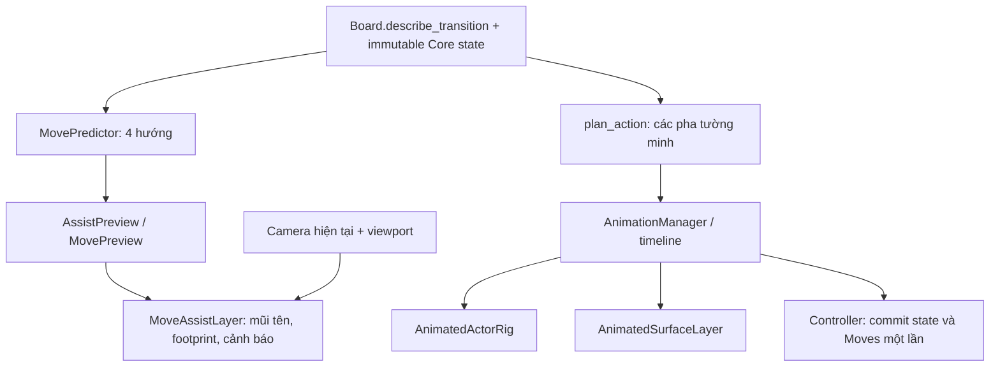

# Move assistance và animation cơ học

Nhánh bàn giao: `feat/phuoc/animation-move-assist`, lấy từ
`feat/team-code/phase2-game-gui` tại baseline `0886d13`.
Tài liệu này mô tả code và kiểm thử ngày 26/10/2026.

## Chạy và sử dụng

```bash
source .venv/bin/activate
python -B main.py
```

Start → trang 2 → **11: Advanced Mechanics Sandbox (9 × 13)** để thử mọi cơ chế.
WASD/mũi tên đi ngay; Settings → Mouse để chơi bằng chuột. Space đổi cube,
C đổi Iso/Top/Follow, H/F1 mở Tutorial, R restart.

Hỗ trợ di chuyển bật mặc định trong cả hai chế độ:

- Xanh `OK`: Core cho phép nước đi.
- Đỏ `!`: chắc chắn rơi hoặc làm vỡ fragile; click/phím vẫn thực hiện.
- Xám `X`: Core chặn hành động, ví dụ hai cube đè lên nhau.
- Viền vàng chỉ đánh dấu các cạnh đang kề ô thiếu sàn/cầu đóng; dòng `Near edge`.
- Hover một hướng hiện đầy đủ footprint đáp và thông báo bằng tiếng Anh.
  Split thêm marker tại hai đích teleport; merge dùng footprint khối sau nhập.
  Mất sàn dưới cube còn lại được ghi rõ `Cube 1` hoặc `Cube 2`.
- Ô ngoài bản đồ chỉ có viền, không sinh sàn hay snapshot giả.
- Mũi tên được bố trí theo phép chiếu để tránh bị khối cao che; cỡ chữ giữ khoảng
  12 pixel. Click vào tâm mũi tên khớp hướng dự báo ở ba camera và mọi tư thế.
- Hover bị xóa trên HUD, cả vùng tên màn/metrics không nhận sự kiện chuột,
  hoặc khi chuột rời viewport. Cảnh báo sát biên của trạng thái hiện tại vẫn có
  thể còn hiển thị; đó không phải dự báo một nước đi phía sau HUD.

Guide ẩn trong intro, Tutorial, animation, tìm kiếm/replay (kể cả Pause), bảng
kết quả và cửa sổ dưới kích thước hỗ trợ. Tutorial đã có hướng dẫn màu/ký hiệu;
Esc đóng Tutorial trước khi thực hiện điều hướng menu.

## Luồng dữ liệu và quyền sở hữu



`src/gui/move_assist.py` là Python thuần, không import Panda3D hoặc solver.
`predict_moves()` lấy kết quả/phán quyết từ Core, không viết lại luật lăn,
fragile, công tắc, tách hay nhập. DTO assist chấp nhận tọa độ ngoài board;
DTO render vẫn giữ kiểm tra tọa độ hợp lệ.

`MovePredictor` giữ đúng một cache theo `(board, session, state)`. Core state
bao gồm bridge flags, vị trí hai cube và active cube. Camera, hover và mỗi frame
chỉ thay phép chiếu/hiển thị. Các test xác nhận gọi lặp cache 120 lần không gọi
lại bốn transition, không sửa board/state và không import solver.

`src/gui/move_arrows.py` cung cấp `MoveAssistLayer`; `MoveArrows` còn là alias
để tương thích host cũ. Lớp sở hữu task, root, text và overlay; dispose giải phóng
chúng. Overlay chỉ dựng lại khi state/hover đổi. Luồng click dùng cùng hệ phép
chiếu với guide và bỏ qua các dải HUD thụ động.

`plan_action()` chuyển một kết quả Core thành toàn bộ chuỗi request. Pha vào
đích nằm cuối cùng trong action này. Controller chỉ commit Core state, tăng
Moves và thông báo thắng khi pha đó hoàn tất. Nước đi thất bại giữ cách đếm
Moves của baseline. Không sửa `src/core/`, `src/solvers/`, schema level,
chi phí, đường đi hoặc mã đo metrics.

## Animation tại 1×

| Cơ chế | Timeline | Bất biến |
|---|---|---|
| Lăn | 0,35 s | Pivot cạnh chính xác, easing nâng/chuyển trọng lượng/tiếp đất; không bounce, không đổi kích thước |
| Fragile | crack/sag 0,12 s, fall 0,9 s | Sáu mảnh có wrapper riêng, đường rơi/spin xác định; rơi cùng actor trong terminal |
| Off-board | 0,9 s tổng | Hoàn tất lật rồi rơi tăng tốc, fade ở phần cuối; chỉ actor mất sàn rơi |
| Goal | 0,9 s | Thu đến 70% trong 35% thời gian đầu, đáy giữ trên z=0; sau đó mới chìm và fade cuối |
| Switch | 0,22 s | Nhấn xuống/hồi, đổi trạng thái theo event được cấp |
| Bridge | 0,22 s | Trượt lên/xuống; scale luôn `(1,1,1)` |
| Split | 0,4 s | Mờ khỏi nguồn, chuyển vị trí khi opacity bằng 0, hiện tại hai đích; không bay xuyên map |
| Merge | 0,3 s | Ghép tại tư thế đích; đối chiếu vị trí để giữ đúng correspondence của hai cube |
| Active cube | 0,15 s | Crossfade dấu nhận biết, không đổi vị trí cube |

Contact shadow dùng pool 12 patch, chỉ đặt trên diện tích sàn/fragile còn nguyên,
không dựng bóng thành sàn trên void/cầu đóng/miệng đích. Mỗi rig có hai bộ mesh
light/dark đồng bộ theme hiện tại. Hoa văn trên khối là decal flush với depth
offset riêng: không làm tăng kích thước cuboid khi một mặt lăn xuống sàn.

Miệng đích vẫn rộng 0,76 ô như baseline; không sửa mesh hố. Trong lúc đáy actor
đi qua z=0, bề ngang đã bằng 0,70 ô. Không dùng physics engine, random runtime,
camera shake hoặc thư viện mới. Pause giữ nguyên pose; rate đổi thời gian
chạy timeline. Step hoàn tất một action gồm mọi pha. Restart/đổi level/thoát
hủy callback cũ, phục hồi scale/opacity, ẩn pool mảnh vỡ và giải phóng scene cũ.

### API bổ sung, tương thích request cũ

```python
TerminalVisualOutcome(
    EventKind.FALL,
    actor_id=None,
    fall_distance=3.0,
    roll_direction=None,
    collapse_cell=(row, col),  # mới, mặc định None
)
```

`collapse_cell` chỉ dùng cho FALL, phải trỏ tới fragile đã broken trong
`before_snapshot` và cần `AnimatedSurfaceLayer` được nối rõ ràng. Terminal vẫn
có đúng một event FALL; không chèn event phụ làm đổi schema request hoặc API
solver. Các fixture/request cũ không truyền metadata vẫn hợp lệ.

## Phân loại baseline và xử lý

Lệnh baseline chạy trực tiếp ở `0886d13`: **446 tests, 48 failure**, có các
failure là subtest. Không suy ra số test pass bằng cách trừ 48 khỏi 446.

| Nhóm | Failure | Xử lý |
|---|---:|---|
| Camera/framing | 41 | Khôi phục padding Iso 13%, dành chỗ cho guide; giữ nguyên kiểm tra frustum/clipping cũ |
| Khối có hoa văn vượt support plane | 1 | Sửa decal flush thật sự; không nới sai số xuyên sàn |
| Hình học glyph mới của fragile/switch | 2 | Đối chiếu mesh từ merge Tài: crack cao 0,014; base soft 0,005, heavy/split 0. Test kiểm tra đúng kích thước này, vẫn kiểm tra support plane, normal/winding và pitch |
| HUD icon thay text/Close | 3 | Test theo toolbar icon hiện tại, View/Tutorial và AI toggle; vẫn kiểm tra trạng thái disabled, fit của text thật, resize/identity |
| Backdrop ảnh thay gradient mặc định | 1 | Test fallback chủ động giả lập thiếu ảnh; thêm test riêng cho backdrop ảnh unlit/depth/shadow |

Không bỏ qua, xfail hay xóa test để làm xanh. Không còn failure baseline sau
khi xử lý. Ngoài phạm vi animation: mục benchmark của README còn nhắc
`benchmark.py`/CSV nhưng repo chưa có script đó; đợt này không triển khai benchmark.

## Kiểm chứng

Kết quả ở working tree sau triển khai:

- **471 tests pass** sau tích hợp vào team-code (466 ở nhánh tính năng, thêm 5 test theme), gồm các subtest pose/hướng/camera.
- Preview được đối chiếu với Core trên các trạng thái đi được của catalog,
  cả ba tư thế, hai active cube, bridge flags, fragile, split/merge, đè cube,
  inactive cube mất sàn và split có đích nguy hiểm.
- Animation kiểm tra mọi profile ở **30/60/120 FPS × 0,25×/1×/4×**; pose cuối
  giống nhau. Pause/cancel tại đầu, giữa, sát cuối; pivot/corners không xuyên sàn;
  goal không chìm khi còn rộng hơn hố; sáu fragment có spin khác nhau.
- **66/66 lượt GUI solver/replay**: sáu thuật toán × 11 màn, kể cả DFS sandbox
  528 bước. Tool kiểm tra guide không xuất hiện trong replay, path length bằng
  Moves và metrics được đưa lên HUD. Sau dispose: 0 widget, subscription,
  graphics output và task.
- Native X11/XTest: **33 nhóm kiểm tra** bằng click/phím press/release thật,
  hai chế độ, hai theme, ba camera; hover tâm mũi tên; cả hai active cube;
  Tutorial/Esc; ba tốc độ; cảnh báo đỏ vẫn cho đi/thua; Pause/Step; resize;
  restart/đổi level/Exit giữa fragile/fall/split/goal; 10 restart không tăng task.
- Tool split mouse riêng đối chiếu 24 nước đi độc lập và 3 trường hợp nhập khối.

Lệnh chạy lại (game không cần Xvfb; các lệnh `xvfb-run` dùng cho QA Linux):

```bash
.venv/bin/python -B -m unittest discover -s tests
xvfb-run -a -s '-screen 0 1600x1000x24 +extension GLX' \
  .venv/bin/python -B -m tools.move_assist_smoke
xvfb-run -a -s '-screen 0 1600x1000x24 +extension GLX' \
  .venv/bin/python -B -m tools.game_integration_smoke --all
xvfb-run -a .venv/bin/python -B -m tools.split_mouse_smoke
xvfb-run -a .venv/bin/python -B -m tools.animation_capture \
  --output /tmp/bloxorz-animation-capture
```

`tools/native_input.py` dùng X11/XTest qua thư viện chuẩn `ctypes`; chỉ phục vụ
QA Linux. `animation_capture` xuất frame PNG từ framebuffer thật của các demo
DTO, có nhãn **NOT GAMEPLAY**. Mảnh fragile demo có thể bị actor/sàn xung quanh
che theo góc nhìn; clip gameplay sandbox bổ sung cho kiểm chứng cơ chế thực.
Không bổ sung Pillow/ffmpeg vào dependency game để tạo GIF.

Ảnh, GIF và log kiểm chứng trên máy này được đặt ở
`/tmp/bloxorz-assist-qa/README.md`. Có bộ before từ checkout export `0886d13`,
after từ code mới cho chín nhóm animation; ảnh gameplay/guide, clip fragile
sandbox thật và các báo cáo native JSON. Đây là bằng chứng cục bộ, không phải
asset runtime hoặc file cần đưa vào Git.


## Tích hợp theme trên team-code

Tích hợp nhánh `feat/phuoc/animation-move-assist` (`61d7233`) vào
`feat/team-code/phase2-game-gui` đang ở `8b03a83`. Git tự gộp được
`mesh_factory.py` và `screens.py`, không có conflict văn bản.

Commit mới của team-code bổ sung palette light/dark cho các ô đặc biệt. Lớp
`AnimatedSurfaceLayer` đã được nối với cùng `TILE_THEME`: tạo sẵn hai variant
`TileTheme-light/dark` cho fragile, cầu, cả ba loại công tắc và sáu mảnh vỡ.
Mảnh vỡ lấy đủ màu mặt/cạnh/thân từ palette hiện tại. Khi theme đổi, chỉ chọn
variant tương ứng; không tạo lại mesh hoặc thêm task theo frame. Khi dispose,
layer giải phóng toàn bộ handle variant. Animation và renderer tĩnh dùng cùng
màu, không nháy về light khi đang chạy ở dark.

Năm regression test trong `test_surface_animation_theme.py` kiểm tra màu trước/
trong/sau bridge, fragile và mọi switch; sáu mảnh rơi; đổi theme trong Pause
không đổi pose hoặc tăng node; level mới kế thừa dark và dispose sạch. Test
pipeline cũ tìm `GoalMesh` được cập nhật thành `GoalMesh-light`, đúng tên mesh
mới của team-code; các kiểm tra hình học/hố/không sinh sàn vẫn giữ nguyên.

Kiểm chứng native bổ sung: soft/heavy bridge, split switch và fragile/debris
trên game thật ở cả hai theme; ảnh và kết quả được lưu cục bộ trong
`/tmp/bloxorz-team-merge-ui/themes`. Bộ UI chung được chạy lại trong
`/tmp/bloxorz-team-merge-ui/manual`; bộ solver/replay trong
`/tmp/bloxorz-team-merge-ui/solvers`.
