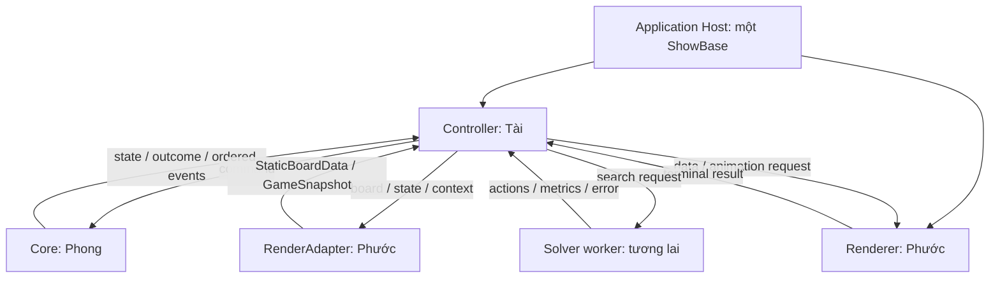
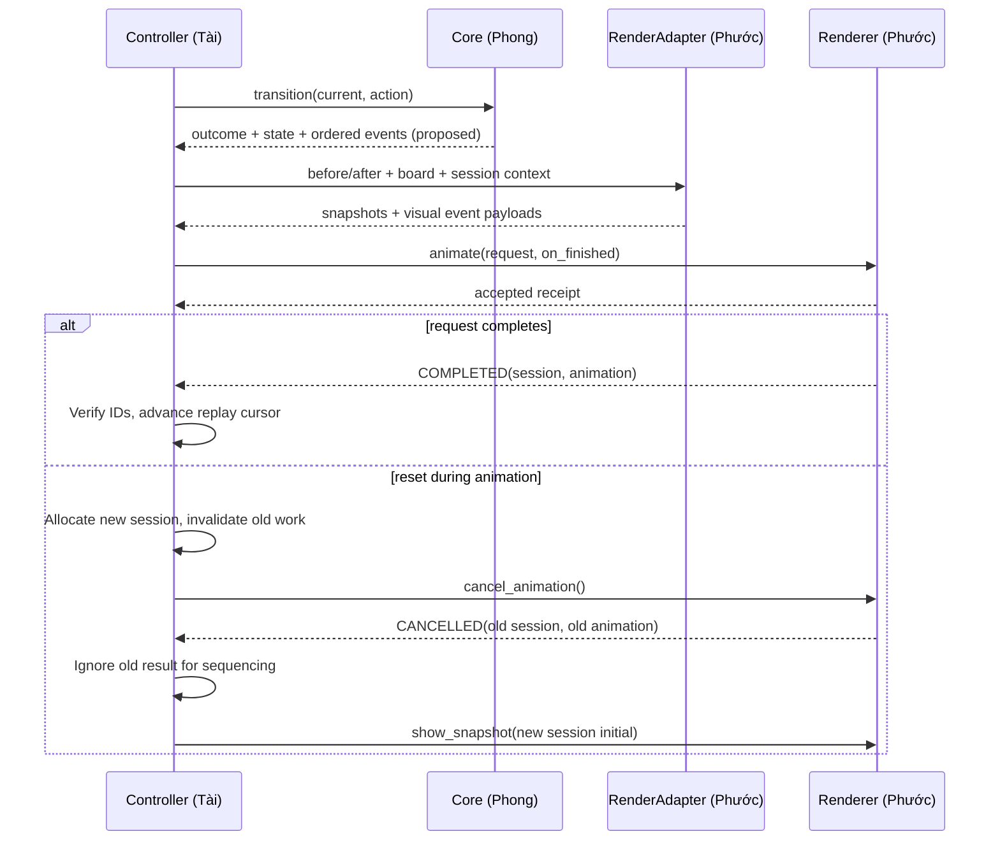

# 2.4 — Render Contracts & Animation Interface

**PROPOSED CONTRACT / PENDING TEAM APPROVAL / NOT IMPLEMENTED.** Schema đề xuất **v1**; đây là mô tả interface và dữ liệu minh họa, không phải class/API đang có trong repository. Các quyết định visual được khóa riêng ở [Visual](VISUAL_SPEC.md); contract không tự tạo team approval.

## Mục lục

1. [Kiến trúc và ownership](#kiến-trúc-và-ownership)
2. [Vocabulary và invariants](#vocabulary-và-invariants)
3. [StaticBoardData](#staticboarddata)
4. [GameSnapshot](#gamesnapshot)
5. [HUD View Model](#hud-view-model)
6. [RenderAdapter và Basic mapping](#renderadapter-và-basic-mapping)
7. [Renderer API](#renderer-api)
8. [AnimationRequest và AnimationResult](#animationrequest-và-animationresult)
9. [Lifecycle và session](#lifecycle-và-session)
10. [Semantic events](#semantic-events)
11. [Solver và replay](#solver-và-replay)
12. [Versioning, approval và nghiệm thu](#versioning-approval-và-nghiệm-thu)

## Kiến trúc và ownership



Controller giữ authoritative current state, mode và replay cursor. Core quyết định successor, passability, goal và event order. Adapter chỉ chuyển dữ liệu. Renderer sở hữu nodes, camera, lights, visual interpolation, completion. Controller không nhận NodePath nội bộ. Core/solver/contracts không import Panda3D. Host tạo và hủy ShowBase đúng một lần; không gọi event loop khác.

HUD visual do Phước, dữ liệu/callback hành vi do Tài. Host lifecycle và wiring là shared boundary; mặc định đề xuất Phước phụ trách host engine, Tài phụ trách kết nối Controller. Phong review Renderer và domain mapping.

## Vocabulary và invariants

| Thuật ngữ | Quy ước |
|---|---|
| Required | Field phải có; một số field có thể null theo điều kiện được nêu rõ |
| Optional | Có thể không gửi; không được tự điền kết quả gameplay |
| Not applicable (N/A) | Null có ý nghĩa chắc chắn theo mode, ví dụ orientation khi SPLIT |
| Unknown/unsupported | Không biết hoặc không có capability; không giả làm false/empty. Reject nếu cần để vẽ đúng; game_status UNKNOWN được cho phép rõ |
| Cell | Cặp `[row,col]` số nguyên, không bool; JSON chỉ là dạng minh họa, DTO tương lai dùng dữ liệu độc lập/immutable |
| Identity | `level_id` là ID ổn định; `board_revision` là fingerprint nội dung tĩnh; session không tái sử dụng trong một lần chạy |
| Revision | `state_revision` nguyên không âm, tăng theo logical action/session update, không theo frame animation |

Không đưa mutable reference của Board/grid/state vào DTO. Tạo bản sao/immutable containers; mọi consumer coi dữ liệu chỉ đọc. Không dùng visual quaternion hoặc frame time làm identity Core. Không dùng callback completion để kết luận nước đi hợp lệ: Core đã quyết định trước request.

## StaticBoardData

| Field | Kiểu/điều kiện đề xuất | Nguồn hiện tại |
|---|---|---|
| `schema_version` | Required int, v1 là 1 | Adapter contract, không phải Core schema version |
| `level_id` | Required nonempty string | Host cung cấp, ví dụ relative level path; Board chưa có field này |
| `board_revision` | Required nonempty string | Host/adapter tính từ nội dung tĩnh canonical, không dựa mtime |
| `rows`, `cols` | Required int >0 | Board.rows/cols |
| `tiles` | Required sequence đúng rows×cols, mỗi cell một entry | Board.grid qua mapping bên dưới |
| `goal_cells` | Required sequence cell; Basic đúng một | Board.goal_r/goal_c |
| `bridge_definitions` | Required sequence; Basic empty nếu không có advanced | Chưa có mapping Core |
| `switch_definitions` | Required sequence; Basic empty | Chưa có mapping Core |
| `capabilities` | Required sequence semantic feature IDs; Basic `["BASIC"]` | Contract tự mô tả, không chứng minh Core đã hỗ trợ Advanced |

Tile entry đề xuất: `{cell, kind, raw_code?}`. `kind` semantic: VOID/FLOOR/GOAL ở Basic; FRAGILE/BRIDGE/SOFT_SWITCH/HEAVY_SWITCH/SPLIT_SWITCH ở tương lai. `raw_code` chỉ diagnostic, không là nguồn luật thứ hai. Không đặt Panda material/mesh path vào Core; renderer ánh xạ kind sang visuals.

Bridge definition tương lai: stable `bridge_id`, `cells`; profile visual tùy chọn. Switch definition: stable `switch_id`, `cell`, `kind`, linked IDs và metadata domain Phong xác nhận. Không đoán toggle/permanent hoặc initial state từ tên.

Fingerprint đề xuất: SHA-256 của canonical representation gồm dims, semantic tiles, goal, bridge/switch definitions và capabilities; không gồm chính fingerprint, file mtime hoặc dynamic state. Theme change có thể reload visuals riêng, không làm đổi luật Core. Cách canonical hóa phải deterministic và được chốt khi implement.

## GameSnapshot

`RenderSnapshot` là khái niệm bao quát của snapshot; **chỉ dùng DTO tên GameSnapshot**.

| Field | WHOLE | SPLIT (tương lai) | Nguồn/ghi chú |
|---|---|---|---|
| `schema_version` | Required 1 | Required 1 | Thêm để reject mixed versions |
| `session_id` | Required int tăng theo session | Như WHOLE | Controller; Basic host có thể cấp context cho kiểm thử tĩnh |
| `state_revision` | Required int ≥0 | Như WHOLE | Controller |
| `board_revision` | Required khớp board loaded | Như WHOLE | Context từ StaticBoardData |
| `block_mode` | Required `WHOLE` | Required `SPLIT` | Basic được biết là nguyên khối; Core mở rộng pending |
| `orientation` | Required STANDING/HORIZONTAL/VERTICAL | Required null, N/A | State.orientation ở Basic |
| `anchor_cell` | Required cell | Required null, N/A | State.r/c ở Basic |
| `occupied_cells` | Required 1 hoặc 2 cells | Required union hai cube positions | Source method hiện chỉ WHOLE |
| `bridge_states` | Required ID→bool map | Như WHOLE | Basic `{}` chỉ khi flags `()` và definitions empty |
| `cubes` | Required null, N/A | Required 2 entries `{cube_id,cell}` | Advanced chưa có |
| `active_cube_id` | Required null, N/A | Required một ID trong cubes | Chưa có |
| `switch_states` | Optional ID→semantic state map | Optional | Basic empty/omitted khi definitions empty; thiếu với advanced cần hiển thị thì unsupported |
| `tile_overrides` | Optional cell→visual semantic override | Optional | Không tự sinh fragile broken |
| `game_status` | Required PLAYING/WON/LOST/UNKNOWN | Như WHOLE | Controller lấy kết quả Core; Basic tĩnh có thể UNKNOWN |

WHOLE invariant: occupied cells đúng orientation/anchor; không trùng; trong board đối với snapshot hợp lệ đang chơi. SPLIT: hai cube IDs khác nhau, vị trí và active ID có nguồn domain; quy tắc có được cùng ô/kề nhau không chờ Phong. Renderer không tự merge theo khoảng cách.

Không diễn giải tuple bridge flags bằng `enumerate()` thành ID giả. Flags không rỗng mà thiếu definitions/mapping là **unsupported**, không chuyển thành `{}`. Không giả trạng thái switch chỉ từ occupied cells. Tile overrides không thay static definitions của level.

LOST chưa có final-state semantics được Core xác nhận. Nếu Core không có state hợp lệ sau fall, không ép tạo một BloxorzState ngoài biên để vượt validator; dùng terminal animation case ở dưới, chờ Phong duyệt.

### Ví dụ Basic minh họa

Ví dụ fragment sau không phải output đã chạy; board tiles phải đủ 28 entries khi triển khai. `board_revision` trong fixture được host khai báo khớp, không giả là hash đã tính.

```json
{
  "schema_version": 1,
  "session_id": 1,
  "state_revision": 0,
  "board_revision": "fixture-basic-4x7-v1",
  "block_mode": "WHOLE",
  "orientation": "STANDING",
  "anchor_cell": [1, 1],
  "occupied_cells": [[1, 1]],
  "bridge_states": {},
  "cubes": null,
  "active_cube_id": null,
  "game_status": "UNKNOWN"
}
```

Static fragment minh họa tương ứng có `rows=4`, `cols=7`, `goal_cells=[[1,6]]`, capabilities `["BASIC"]`, definitions empty và đúng cùng board_revision. Không được copy fragment thiếu tiles thành một board hợp lệ.

## HUD View Model

HUD world data tách GameSnapshot. Đề xuất một HUD view có `show_hud(model)` riêng; Controller/host cung cấp model, renderer không tự gọi solver để điền số.

| Field | Kiểu/quy ước | Nguồn |
|---|---|---|
| `schema_version`, `session_id` | Required 1 và session hiện tại | Contract/Controller |
| `level_name` | Required string; fallback level_id | Host/Controller; Board không có thuộc tính name |
| `gameplay_status` | Required status/UNKNOWN | Controller/Core |
| `move_count` | Optional nonnegative int hoặc null | Controller; không đếm theo frame |
| `solver_name` | Optional string hoặc null | Controller |
| `solver_status` | Required NOT_RUN/RUNNING/SUCCEEDED/NO_SOLUTION/ERROR/CANCELLED/TIMED_OUT | UI state do Tài quản lý, không phải field hiện có trên SearchResult |
| `search_time_seconds` | Optional finite ≥0 hoặc null | SearchResult.time_taken |
| `expanded_nodes` | Optional int ≥0 hoặc null | SearchResult.expanded_nodes |
| `solution_length` | Optional int ≥0 hoặc null | SearchResult.solution_length; xem success trước |
| `peak_python_memory_kib` | Optional finite ≥0 hoặc null | SearchResult.peak_memory |
| `playback_rate` | Optional finite >0 hoặc null | Controller |
| `controls_enabled` | Optional command→bool | Controller; Basic shell tất cả gameplay commands disabled |

Null/không có dữ liệu dùng `—`. Failure không được hiển thị length=0 như một lời giải thành công; `actions=[]` khác `actions=None`. Metrics được reset/đánh dấu unavailable khi bắt đầu search mới theo Tài, không lưu số cũ như kết quả mới.

`peak_python_memory_kib` là peak traced Python allocations của phép solve, không phải process RSS, peak VRAM hay tổng bộ nhớ game. Header/status/metrics không dùng callback của session cũ. UI text phải dùng font/formatting đã chốt ở [Visual](VISUAL_SPEC.md).

## RenderAdapter và Basic mapping

Đầu vào đề xuất: Board, State và render context do host/Controller cấp (IDs, revision, status). Đầu ra: StaticBoardData và GameSnapshot. Adapter có thể đọc `get_occupied_cells()`, `is_standing()` và API validation có sẵn; không gọi transition để tạo gameplay mới, không ghi `grid`, không gán State fields, không reimplement switch/goal rules. DTO/adapter thuần Python, không cần Panda3D.

Basic supported profile đề xuất:

1. Xác minh rows/cols/grid phù hợp; cell nguyên, orientation được hỗ trợ, occupied footprint khớp.
2. Tọa độ goal từ Board là authoritative: cell đó map GOAL bất kể mã 1/2.
3. Grid 0 map VOID; grid 1 map FLOOR; grid 2 ngoài tọa độ goal map FLOOR (baseline không coi đó là goal).
4. Mã khác 0/1/2 bị adapter Basic từ chối có thông báo rõ, không tự gán thành fragile/bridge hoặc đánh tráo thành Advanced đã hỗ trợ. Đây là giới hạn GUI Basic, không đổi hành vi Board vốn coi mọi nonzero là sàn.
5. Chỉ xuất bridge map empty khi source flags thực sự rỗng và không có definitions. Nếu flags chưa ánh xạ, báo unsupported.
6. Không suy ra LOST từ `transition()==None`; không tạo events Advanced từ phỏng đoán.

Validator lỗi cần gồm mã/category, field path và message ngắn. Kiểu lỗi dự kiến trong tài liệu: INVALID_DATA, VERSION_MISMATCH, UNSUPPORTED_TILE, UNSUPPORTED_CAPABILITY, REVISION_MISMATCH; chưa có exception class nào như vậy trong source. Không mutate đầu vào kể cả khi validation thất bại.

## Renderer API

Tất cả method dưới đây là **đề xuất**, gọi trên host/main thread. Output command chung là receipt dữ liệu `{accepted, reason?}`; reject trước acceptance không phát AnimationResult. Không trả NodePath nội bộ. Lỗi engine không dự kiến phải được báo cho host, không bị nuốt thành thành công.

**Chặng 3 chỉ cần load_board, show_snapshot, dispose và HUD shell**. Những method animation bên dưới dành chặng sau; không bắt coding agent triển khai hoặc giả completion của chúng trong Basic.

### load_board(board_data)

- Input: StaticBoardData v1 đã validate; caller không thay dữ liệu sau khi gửi.
- Preconditions: renderer chưa disposed; IDLE; không có accepted animation đang pending.
- Output: receipt. Reject VERSION_MISMATCH/INVALID_DATA/UNSUPPORTED_CAPABILITY hoặc busy; không đổi scene cũ khi validation fail.
- Postconditions accepted: thay board geometry atomically về mặt quan sát giữa frames, reset binding snapshot/session của board cũ, fit camera. Chưa có current block cho đến show_snapshot.
- Ownership: Phước thực thi; host/Controller chọn lúc load. Không tự load level file/solver trong renderer.

### show_snapshot(snapshot)

- Input: GameSnapshot; board_revision khớp board loaded.
- Preconditions: IDLE, chưa disposed, DTO được hỗ trợ. Snapshot cùng session phải không lùi revision; cùng revision chỉ được lặp lại cùng nội dung để idempotent.
- Output: receipt, reject nếu busy, stale, mismatch hoặc unknown dữ liệu bắt buộc; scene hiện tại giữ nguyên khi reject.
- Postconditions accepted: world visual khớp snapshot tức thời; bind session đầu tiên hoặc session mới lớn hơn, bỏ visual transient và đánh dấu synchronized. Không tự đổi logic state.
- Session mới chỉ được caller gửi sau cancellation barrier. Không dùng show_snapshot như một cách hủy ngầm animation.

### animate(request, on_finished)

- Input: AnimationRequest và callback nhận AnimationResult; callback do Controller sở hữu.
- Preconditions: IDLE, synchronized, before khớp session/revision/board và pose đang hiển thị; animation_id chưa dùng trong session; rate hợp lệ, capability/event hỗ trợ.
- Output: accepted/rejected receipt; Basic renderer chưa hỗ trợ phải reject UNSUPPORTED_OPERATION, không giả một roll đã chạy.
- Postconditions accepted: chuyển ANIMATING, giữ before/after/request immutable; tối đa một terminal result. Nếu COMPLETED, visual khớp after; FAILED không tự chạy bước tiếp.
- Renderer không lặp toàn solution path. Busy request bị reject, không có queue ẩn để Tài mất quyền sequencing.

### pause_animation() và resume_animation()

- Input: không có; dùng active request hiện tại, không nhận state mới.
- Pause chỉ đổi ANIMATING→PAUSED, đóng băng progress và request-owned effects. Resume PAUSED→ANIMATING với progress cũ.
- Output receipt; gọi lặp lại trạng thái mong muốn là no-op accepted; IDLE trả no-active-animation; disposed reject.
- Không phát terminal result, không đổi current logical state/revision. Controller quyết định khi nào pause/resume.

### set_playback_rate(rate)

- Input finite number >0, không bool; UI range khởi điểm đề xuất 0.25×–4×, mặc định 1×. Slider bounds thuộc Controller, không clamp im lặng tại renderer.
- Output receipt, reject invalid/disposed. Accepted lưu rate cho request đang chạy và request tiếp theo; một request mới phải dùng rate đã thống nhất, không âm thầm ghi đè khác giá trị Controller.
- Thay rate không làm nhảy progress; PAUSED vẫn pause. Rate=0 không phải pause. Khoảng nghỉ giữa steps do Tài, không là rate.

### cancel_animation()

- Input: không có; Controller đã biết active animation/session IDs.
- Preconditions: renderer sống. IDLE là no-op receipt không có terminal mới.
- Khi accepted active request: dừng mọi interval/task của request, gỡ pivot tạm, trả IDLE và đánh dấu cần resync; visual có thể ở pose giữa chừng, không xem đó là State hợp lệ. Phát CANCELLED một lần, không COMPLETED.
- Caller phải gửi show_snapshot hoặc load_board + show_snapshot trước animate tiếp theo. Cancel không sửa Core và không tua về after-state.

### dispose()

- Idempotent, không có input; hủy tài nguyên do renderer sở hữu, không hủy một ShowBase do host sở hữu.
- Nếu active, kết thúc theo CANCELLED; cleanup callbacks/tasks/intervals/nodes. Các method khác sau disposed reject; dispose lần hai no-op.
- Host phải ngừng commands, cancel và drain terminal notifications trên main thread trước khi destroy event loop. Không để interval callback cũ truy cập nodes đã giải phóng.

## AnimationRequest và AnimationResult

| AnimationRequest field | Điều kiện |
|---|---|
| `session_id` | Required, khớp before/session hiện tại |
| `animation_id` | Required nonempty ID duy nhất trong session |
| `action` | Required semantic token Core/Controller thống nhất; Basic U/D/L/R, action mới pending |
| `before_snapshot` | Required synchronized snapshot |
| `after_snapshot` | Required snapshot sau một action, cùng board/session và revision tăng; có thể null **chỉ** terminal case đã được duyệt |
| `events` | Required ordered list, Core cung cấp/được giao thức Basic xác nhận; không tự sắp xếp |
| `playback_rate` | Required finite >0, khớp rate Controller |

Terminal case tương lai: FALL có thể không có valid after-state; after_snapshot=null chỉ được nhận khi ordered events/outcome cung cấp terminal visual pose và kết quả loss rõ. V1 Basic không hỗ trợ case này. Phong phải chốt final-state semantics trước khi bật capability; không đổi tất cả `None` của Board thành fall.

| AnimationResult field | Điều kiện |
|---|---|
| `session_id`, `animation_id` | Required, giữ nguyên request |
| `status` | Required COMPLETED / CANCELLED / FAILED |
| `error` | Required nếu FAILED: code và message; null/omitted với trạng thái khác |

Một accepted request có tối đa một terminal result; trong lifecycle bình thường complete/cancel/failure phải kết thúc bằng result. Rejected request không phát result. Callback dùng host dispatcher trên main thread, giao sau khi cleanup/state transition đã xong, tránh re-entrant callback ngay trong animate. Host drain notifications trước shutdown; không dùng process exit đột ngột làm bằng chứng callback được bảo đảm.

Nếu complete/cancel tranh nhau trong một frame, terminal guard quyết định kết quả đầu tiên; không phát kết quả thứ hai. Callback mang IDs gốc dù session hiện tại đã khác. FAILED trả IDLE, cần authoritative show_snapshot trước tiếp tục; Controller hiện lỗi, không tự next action.

## Lifecycle và session

Trạng thái công khai của animation: **IDLE / ANIMATING / PAUSED**. Disposed là lifecycle flag ngoài ba trạng thái; synchronized là điều kiện dữ liệu, không phải state gameplay.

| Trigger | Before | After | Terminal/synchronization |
|---|---|---|---|
| Accepted animate | IDLE synced | ANIMATING | Chưa terminal |
| Complete | ANIMATING | IDLE synced | COMPLETED, pose=after |
| Pause | ANIMATING | PAUSED | Không terminal |
| Resume | PAUSED | ANIMATING | Không terminal |
| Speed change | Bất kỳ trạng thái sống | Giữ state | Giữ progress |
| Cancel | ANIMATING/PAUSED | IDLE unsynced | CANCELLED |
| Runtime animation failure | ANIMATING/PAUSED | IDLE unsynced | FAILED |
| Reset/new level | Controller đổi session | IDLE rồi snapshot mới | Cancel cũ; ignore result cũ |
| Shutdown | Bất kỳ | Disposed | Ngừng commands, cancel, drain, dispose, host destroy |



Sequence minh họa không chứng minh Core đã có outcome/events. Reset cùng board không rebuild static geometry; change level gọi load_board. Tăng session trước cancel để old callback không có cơ hội điều khiển phiên mới. Session mới dùng state_revision=0 được phép; revision reset không hợp lệ trong cùng session. HUD và solver results cùng tuân thủ session filtering.

## Semantic events

Tất cả tên/payload dưới đây **PROPOSED CONTRACT**; source hiện chưa xuất event nào, kể cả ROLL. Advanced đều PENDING TEAM APPROVAL.

| Event | Payload cần thống nhất | Người xác nhận |
|---|---|---|
| ROLL | actor ID/mode, direction, before/after pose | Phong + Phước |
| SWITCH_ACTIVATED | switch ID, activation type/state | Phong |
| BRIDGE_CHANGED | bridge ID, before/after state | Phong |
| FRAGILE_BROKEN | cell(s), affected actor nếu có | Phong |
| SPLIT | source actor, stable cube IDs, destinations | Phong |
| MERGE | cube IDs, whole pose, resulting identity | Phong |
| TELEPORT | actor ID, source/destination, ordering | Phong |
| FALL | affected actor, terminal visual trajectory/pose, loss outcome | Phong |
| GOAL_REACHED | actor, cell, outcome thắng | Phong |

Không suy ra thứ tự roll/switch/bridge/fall từ việc nhìn thấy hai snapshots. Adapter có thể ánh xạ tọa độ trong event, không thay thứ tự hoặc thêm luật. Các event liên tiếp có quan hệ phải nằm trong sequence; chỉ parallel khi được semantics cho phép. Phong xác nhận event names, payload, ordering, rejected vs lost và final-state semantics trước Advanced.

## Solver và replay

VERIFIED IN SOURCE: solve đồng bộ, lấy initial state; SearchResult không có timeout/cancel/total cost tổng quát. `actions=[]` là thành công zero-step; `None` là không có nghiệm, exception là lỗi. Driver UCS CLI không phải API chọn level cho GUI.

Default PROPOSED: Solve từ initial; reset về initial trước replay. Giải từ current state đòi contract solver riêng. Tài sở hữu selection, search request, path, replay cursor, pause, step, speed, reset/cancel và worker lifecycle. Phước chỉ nhận một request và callback.

Không gọi solve chặn main loop. Worker process là ứng viên, không implementation Stage 2/3. Worker nhận dữ liệu Python serialize được, không nhận Panda objects; request/session ID bắt buộc. Bỏ kết quả stale không tương đương dừng worker; Tài phải có chiến lược timeout/cancel thật và shutdown. Một search tại một thời điểm tránh cạnh tranh phép đo tracemalloc; render allocations trong cùng process cũng làm sai ý nghĩa metric solver. Không đổi định nghĩa peak memory trong HUD.

Nguồn kỹ thuật: [Panda Tasks](https://docs.panda3d.org/1.10/python/programming/tasks-and-events/tasks), [Python multiprocessing](https://docs.python.org/3.14/library/multiprocessing.html), [Intervals](https://docs.panda3d.org/1.10/python/programming/intervals/index), [Interval API](https://docs.panda3d.org/1.10/python/reference/direct.interval.Interval). Đây là căn cứ engine/lifecycle, không phải API project đã cài.

## Versioning, approval và nghiệm thu

Đề xuất contract version 1; version Core có thể khác. Reject version không hỗ trợ, không âm thầm bỏ fields Required hoặc diễn giải enum mới. Breaking changes tăng major schema version và review chung. Adapter hấp thụ Core refactor qua mapping, nhưng không thể che thay đổi semantics bằng cách rename field. Examples/tests phải cập nhật cùng contract.

Các câu hỏi bắt buộc được theo dõi bằng Q-P*, Q-T*, Q-G* ở [Handoff](STAGE2_HANDOFF.md). Basic độc lập có thể dùng profile baseline hiện tại, không cần giả dữ liệu advanced. Contract giao tiếp Controller và event Advanced chưa được phê duyệt; không ghi APPROVED cho đến khi có xác nhận cụ thể.

Acceptance thiết kế:

- [ ] DTO không phụ thuộc Panda3D và không mutate Core.
- [ ] WHOLE/SPLIT/null/unknown phân biệt rõ; IDs/revisions consistent.
- [ ] Static scene không rebuild mỗi logical step.
- [ ] Accepted/rejected/terminal semantics rõ; không duplicate callback hoặc cancel→complete.
- [ ] Reset/cancel/shutdown có một chủ sở hữu; stale work không thay đổi session mới.
- [ ] Metrics từ source thật, không fabricated.
- [ ] Phong/Tài review trước Advanced Integration; runtime cases ở [Test Plan](TEST_PLAN.md) còn NOT RUN.
