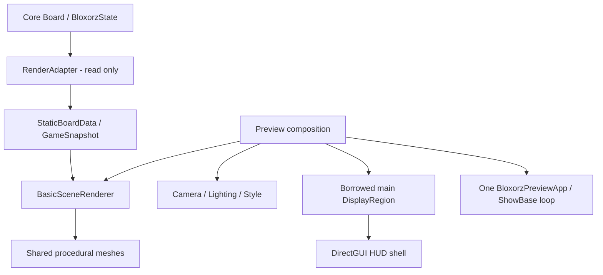

# Stage 3 — Basic 3D Renderer Handoff

**Ngày chốt review: 23/10/2026. Phụ trách: Phước.**

**STAGE 3.7 FINAL HANDOFF COMPLETE** — tài liệu sẵn sàng để gửi Phong/Tài
review. Chưa có team approval, chưa merge và chưa là game hoàn chỉnh.

## 1. Executive summary

Basic Renderer đã có pipeline từ Core Basic hiện tại sang DTO độc lập rồi
render Board/Whole Block 3D, camera/light/material/gradient, responsive HUD và
preview desktop. Regression hiện tại **243/243 PASS** trong GUI venv; không
phát hiện P0/P1 trong phạm vi đã kiểm tra. Native Windows **NOT TESTED**.

Phong/Tài có thể tiếp tục phát triển phạm vi riêng. Gói này mô tả điểm nối,
không yêu cầu hai thành viên thay đổi toàn bộ code ngay. Quyết định tích hợp
và Git delivery được nhóm duyệt sau, không thực hiện trong 3.7.

## 2. Stage 3 completion status

| Chặng | Deliverable | Trạng thái hiện tại / historical note |
| --- | --- | --- |
| 3.1 | Một Panda3D host, roots, native preview | COMPLETE Basic foundation |
| 3.2 | Basic DTO/adapter thuần Python | COMPLETE trong profile0/1/2, WHOLE |
| 3.3 | Procedural geometry, static renderer, 3 poses | COMPLETE Basic static |
| 3.4 | Camera/lighting/style/AA/shadow | Functional; report lịch sử PARTIAL vì helper test3.3; regression repair ở3.5 |
| 3.5 | Responsive viewport/HUD shell +helper fix | COMPLETE; controls disabled |
| 3.6 | Correctness/visual/stability/performance QA | VALIDATION COMPLETE trên Ubuntu, finite scope |
| 3.7 | Architecture/API/team/release documentation | FINAL HANDOFF COMPLETE; approvals PENDING |

Không sửa báo cáo lịch sử3.4 thành COMPLETE. Thứ tự evidence và fix rõ trong
[3.5](STAGE3_5_LAYOUT_HUD.md) và [3.6](STAGE3_6_VALIDATION.md).

## 3. Project architecture



Đây là implementation Basic. Controller/solver/replay/animation chưa được
nối vào flow trên. Dependency graph không có cycle nguy hiểm được tìm thấy;
Core không import GUI, renderer không import Core/solver. Adapter intentionally
phụ thuộc Core để chuyển schema hiện tại.

## 4. Team ownership boundaries

Phong sở hữu luật/domain state và Advanced. Phước sở hữu visuals/adapter và
engine components. Tài sở hữu input, authoritative session/current state,
solver orchestration, replay/reset/cancel. Shared host/dependencies/contracts
cần một owner và review cho mỗi thay đổi. Controller checkout hiện 0 byte;
không suy ra tiến độ thực tế trên nhánh khác.

## 5. Deliverables từ 3.1–3.6

14 implementation modules, 13 GUI test files và một QA tool hiện có, cộng sáu
reports implementation/validation. Cấu hình UI Modern Light Minimal 3D giữ
palette đã chọn. Geometry/font dùng procedural/Panda built-ins; không tải
game template hoặc assets ngoài vào GUI delivery.

## 6. Current source modules

| Module dưới src/gui/ | Trách nhiệm |
| --- | --- |
| app.py | BloxorzPreviewApp, window/loop/roots/destroy |
| contracts.py | Immutable StaticBoardData/GameSnapshot và enums Basic |
| render_adapter.py | Core Basic→DTO, canonical static fingerprint |
| geometry_math.py | Cell/world mapping, canonical block poses |
| mesh_factory.py | Procedural Floor/Goal/Block GeomNode prototypes |
| renderer.py | load/show/clear/dispose, geometry ownership |
| camera.py | Pure fit/bounds/basis và camera/lens resize controller |
| scene_lighting.py | Owned light rig, shadow profile/fallback |
| scene_style.py | Materials/AA/gradient, attribute restoration |
| layout.py | Pure immutable pixel geometry/responsive math |
| viewport.py | Borrow main region, viewport provider/restore |
| hud.py | ViewModel/formatting và disabled DirectGUI shell |
| board_preview.py | Basic loading/renderer/presentation composition |
| dashboard_preview.py | Reuse preview, add viewport/HUD/title/cleanup |

`__init__.py` và `controller.py` vẫn rỗng; không có public package exports,
Controller class, animation module hoặc GUI gameplay entry point ẩn.

## 7. Runtime environment

VERIFIED local: Ubuntu26.04.1, CPython3.14.4, Panda3D1.10.16, X11/GLX,
AMD Radeon Graphics/radeonsi, Mesa26.0.8. pip check sạch. GUI dùng `.venv`,
system Python không có Panda. Shared requirements còn trống; setup/pin cho
nhóm và native Windows test vẫn pending, xem [release checklist](STAGE3_RELEASE_CHECKLIST.md).

## 8. Run Foundation

Từ repository root, **VERIFIED Ubuntu**:

```bash
.venv/bin/python -B -m src.gui.app
```

Chỉ host/background và bốn roots, không Board/HUD. Title Renderer Foundation.

## 9. Run Board Preview

```bash
.venv/bin/python -B -m src.gui.board_preview
.venv/bin/python -B -m src.gui.board_preview --pose HORIZONTAL
.venv/bin/python -B -m src.gui.board_preview --pose VERTICAL
```

Static Board/Block full-window3D, không gameplay. Các pose là inspection
fixtures, không nước đi được tính bằng transition. CLI còn --level/--shadows/--no-aa.

## 10. Run Dashboard Preview

```bash
.venv/bin/python -B -m src.gui.dashboard_preview
.venv/bin/python -B -m src.gui.dashboard_preview --shadows
.venv/bin/python -B -m src.gui.dashboard_preview --no-aa
```

Một host reused, viewport3D bên trái và HUD bên phải; title 3D Preview.
Minimum1024×720. Windows launcher dự kiến `.\.venv\Scripts\python.exe`,
nhưng native Windows **NOT TESTED**, không coi lệnh hướng dẫn là evidence đã chạy.

## 11. Data flow Core→Adapter→Renderer

Caller có Board/State authoritative, gọi build_board_data một lần khi static
content/identity thay đổi, build_game_snapshot theo logical update với caller
session/revision, rồi load_board/show_snapshot. Không truyền Board cho renderer.
Goal lấy từ Board.goal fields; raw code2 ngoài goal vẫn FLOOR. Basic unknown
tile/bridge/split bị reject, không hiển thị giả như đã hỗ trợ Advanced.

## 12. Public API summary

| API đang có | Trách nhiệm |
| --- | --- |
| build_board_data / build_game_snapshot | Đọc Core, detached DTO |
| BasicSceneRenderer.load_board/show_snapshot | Static geometry và instantaneous canonical Whole pose |
| BasicSceneRenderer.clear/dispose | Owned resources, không host roots |
| BoardCameraController.fit_board/set_viewport_size/bind_window | Existing board context, viewport-aware fit/resize |
| HudShell.update_view_model/apply_layout/dispose | Presentation data/layout/cleanup |
| create_preview / create_dashboard | Tạo một app/renderer pair; app.presentation/app.dashboard giữ components |

Exact fields/signatures/errors, two **verified examples** và correct cleanup
sequence tại [BASIC_RENDERER_API](BASIC_RENDERER_API.md). Không có animate,
pause/resume/cancel, receipt accepted/result hoặc action-binding API hiện tại.

## 13. Scene graph ownership

```text
render
├── camera                         # host; Style backdrop attach dưới camera
└── SceneRoot                      # host
    ├── StaticBoardRoot            # host
    │   └── BasicBoardContent      # renderer: Floor/Goal instances
    ├── DynamicTileRoot            # host, chưa advanced content
    ├── BlockRoot                  # host
    │   └── MainBlockVisual        # renderer: một shared block mesh
    ├── EffectsRoot                # host, chưa animation content
    └── PresentationLights         # Lighting owned ambient/key/fill rig
pixel2d
└── DashboardHUD                   # HUD-owned widgets
```

Renderer clear không xóa foreign siblings dưới host roots. Lighting/Style
restore attributes của mình; không có protocol concurrent foreign writes vào
cùng render attributes. Normal shutdown: dashboard→presentation→renderer→host,
nested finally. Host-first callbacks là safety net, không thay renderer.dispose.

## 14. Camera/Viewport integration

Perspective VFOV45°, azimuth30°, elevation45°, full-grid/whole-block envelope,
13% padding mỗi cạnh. Dashboard thu hẹp đúng region của app.cam; camera dùng
viewport aspect, không full window. Camera listener xử lý ShowBase aspect update
mà không override host handlers. Rebind/restore hiện dành cho preview baseline.

Dashboard còn phụ thuộc private `app.presentation._refit`; **P2 R1** trước public
Stage6 integration. Renderer reload không tự refit camera/HUD; **R2** cần owner
coordinator. Không sửa hai điểm nối này trong documentation task.

## 15. HUD input/data semantics

HudViewModel nhận level/status và năm metrics. None→em dash; zero chỉ khi caller
biết thật. Time milliseconds, peak traced Python memory bytes; không RSS/VRAM.
Tất cả action buttons/slider/thumb disabled thật. Update model không bật nút.
Không benchmark/solver hoặc đọc Board trong HUD; Controller tương lai quyết
định statuses/data và action owner trên main thread.

## 16. Confirmed tests và visual evidence

Fresh3.7: **Ran243, PASS243, FAIL0, ERROR0, SKIP0** trong `.venv`.
System: **Ran243, PASS159, SKIP84**, không lỗi. Ba entry points mở/đóng native
exit0; documentation composition example cũng chạy loop thật, outputs sau close0.

Inherited3.6, source không đổi: 18 original screenshots đã xem; 5 sizes, 3 poses,
wide/tall/square/sparse/tiny/edge-goal, shadow/AA; finite stress snapshots/reloads/
resize/recreation giữ node/widget/region/listener counts ổn định. Không rerun
benchmark nặng trong3.7. [Validation3.6](STAGE3_6_VALIDATION.md) có phương pháp,
paths và scope; [checklist](STAGE3_RELEASE_CHECKLIST.md) tách evidence mới/cũ.

## 17. Performance findings

3.6 đo 80 warm-up +360 frames/profile, real4×7 STANDING, window1280×720,
viewport934×530, fresh processes, sync-video request false, 360 foreground và
0 minimized frames. Basic/Enhanced/AA-OFF mean lần lượt **60.052/60.047/60.050 FPS**.
Wall-clock taskMgr.step+syncFrame, có compositor pacing; không GPU-only hoặc
KPI mọi máy. Không suy shadow miễn phí hoặc so trực tiếp với full-window3.4.

## 18. Existing limitations

Basic static preview chưa là game playable. Chưa Advanced/manual input/animated
movement/solver GUI/replay/interactive level picker/final cross-platform/group
integration; chỉ một production level hiện có. English default font, arbitrary
Unicode chưa bảo đảm. Dependency/distribution package chung chưa chốt.

## 19. Known P2/P3 issues

P2 trước integration/release: private refit facade, coordinated reload/refit,
session/stale filtering, portable dependency setup và stable level identity nếu
dùng shared caches. Preview factory dùng absolute path làm level_id, nên revision
không portable giữa checkouts. Goal aperture .76 <block1, depth.14 là P2 trước
goal-sink animation; không sửa luật/mesh tại3.7.

P3: occupancy board+block khoảng41% ngang reference do conservative envelope;
traced heap drift nhỏ nhưng finite counts ổn định, chưa chứng minh leak hoặc
zero-leak. Tuning/long soak cần proposal/evidence riêng. Bằng chứng/file/function,
owner và blocking stage của từng finding tại [R1–R8](TEAM_INTEGRATION_REVIEW.md#4-findings-kiến-trúc--không-tự-refactor).

## 20. Core integration requirements cho Phong

Xác nhận schema/mappings cho tile/fragile/switch/bridge, stableIDs/states,
Whole/Split/active actor/merge/teleport, authoritative outcome/event ordering và
fall/goal terminal semantics/bounds. Nêu API ổn định vs refactor; adapter sẽ
thích ứng khi có thể. [Handoff Phong](TEAM_INTEGRATION_REVIEW.md#2-handoff-cho-phong)
có bảng input thực tế và questions, không ép Core theo rich proposal Stage2.

## 21. Controller integration requirements cho Tài

Chốt final host owner, input/commands, session/revision, stale filtering,
coordinated level change, HUD units/action binding, worker tránh block loop,
reset/cancel/completion semantics. Không Panda objects trong worker; scene/UI
main thread. [Handoff Tài](TEAM_INTEGRATION_REVIEW.md#3-handoff-cho-tài) có 10 câu
hỏi cụ thể. Controls giữ disabled cho tới khi có owner/error/lifecycle đúng.

## 22. Pending team decisions

Mọi decision tại [team table](TEAM_INTEGRATION_REVIEW.md#6-bảng-quyết-định-nhóm)
đều **PENDING TEAM APPROVAL**, không có chữ ký hoặc approval suy đoán. Các thay
đổi từ Stage2 proposals sang Basic implementation được ghi trong
[deviation table](TEAM_INTEGRATION_REVIEW.md#5-stage-2-proposals-so-với-implementation),
đặc biệt string session, None/exception APIs, minimal DTO, units ms/bytes,
goal depth, root names và callbacks chưa triển khai.

## 23. Stage 4 readiness

**Basic foundation READY; Advanced integration CONDITIONAL.** Có engine/visual/data
boundary để chuẩn bị Stage4, nhưng Advanced fields/events cần Phong xác nhận
trước implementation tương ứng. Không tự gán numeric tile codes hoặc expand
DTO v1 âm thầm; không cần dừng công việc Core riêng của Phong để theo GUI.

## 24. Stage 5 readiness

**Basic Rolling design READY WITH REVIEW; implementation chưa bắt đầu.** Có
geometry/bounds/camera nền; cần nhiệm vụ riêng cho pivot trajectory, continuous
face history, before/after snapshots và cancel/completion tests với Tài. Static
canonical orientation không thay visual rotation history. Goal-sink và Advanced
animation còn clearance/domain dependencies, không đánh đồng với roll trên floor.

## 25. Stage 6 integration dependencies

Final host/shutdown owner, public facade thay private integration point,
session/generation filtering, level-load/error policy, worker/solver origin,
units/metrics status và action enabling cần review trước wiring. Đây là
**PROPOSED direction**, chưa có facade method hoặc Controller source để gọi.
Không triển khai Stage6 trong gói này.

## 26. Git status và suggested review scope

Branch feat/phuoc/3d-renderer, HEAD956c0a0 giữ nguyên; staged0. Tracked renderer
modification có từ3.3;3.7 chỉ thêm4Markdown và README index nhỏ. Sau gói bàn giao:
37 untracked files, tracked modified renderer+README. Full candidate BasicPR39
changed/new files; git diff --stat không bao quát untracked.

[Inventory đầy đủ](STAGE3_RELEASE_CHECKLIST.md#5-git-inventory-đầy-đủ) và
[suggested PR scope](STAGE3_RELEASE_CHECKLIST.md#6-ownership-và-đề-xuất-phạm-vi-prcommit)
để Phước duyệt riêng. Không git add/commit/push/merge/remote sync. Source/tests/
tools/Core/Controller/Solver/levels/requirements không đổi trong3.7.

## 27. Links tới tài liệu sâu hơn

- [BASIC_RENDERER_API](BASIC_RENDERER_API.md): source-backed fields/signatures/errors/examples.
- [TEAM_INTEGRATION_REVIEW](TEAM_INTEGRATION_REVIEW.md): findings, deviations, Phong/Tài decisions.
- [STAGE3_RELEASE_CHECKLIST](STAGE3_RELEASE_CHECKLIST.md): tests/platform/Git/attribution/release prerequisites.
- [STAGE3_6_VALIDATION](STAGE3_6_VALIDATION.md): full visual/stability/performance methodology/evidence.
- [STAGE3_5_LAYOUT_HUD](STAGE3_5_LAYOUT_HUD.md): responsive wiring và helper regression repair.
- [STAGE2_HANDOFF](STAGE2_HANDOFF.md): lịch sử design/proposed contract, không current API authority.

## 28. Final conclusion và nghiệm thu3.7

Gói Basic Renderer static và tài liệu hiện sẵn sàng để nhóm review. Không còn
P0/P1 được phát hiện trong Basic scope; P2/P3 integration/future-release items
được ghi rõ, không che bằng lời tuyên bố game complete hoặc zero-leak.
Không gửi thay Phước, không giả Phong/Tài phê duyệt. **Dừng ở3.7** để Phước
review và giao nhiệm vụ tiếp theo khi phù hợp.

| Gate | Status | Evidence |
| --- | --- | --- |
| A Source Truth | PASS | Actual modules/signatures/AST/dependency/lifecycle review |
| B Regression | PASS | 243/243, fresh native smoke và docs examples |
| C Documentation | PASS | Bốn docs, link/example/source verification |
| D Team Handoff | PASS — READY TO SEND | Phong/Tài packages và PENDING table, không approval |
| E Git & Readiness | PASS | Complete inventory, hashes/source unchanged, docs-only, checklist |

| # | Acceptance3.7 | Status |
| --- | --- | --- |
| 1 | Preflight | PASS |
| 2 | Source3.1–3.6 reviewed | PASS |
| 3 | Untracked preserved | PASS |
| 4 | Full regression executed | PASS |
| 5 | Core/Adapter/Renderer/Controller boundaries | PASS |
| 6 | Scene ownership | PASS |
| 7 | Lifecycle/cleanup | PASS |
| 8 | Accurate API reference | PASS |
| 9 | Run commands | PASS |
| 10 | Core→Adapter→Renderer example | PASS — verified native |
| 11 | HUD/ViewModel reference | PASS |
| 12 | Camera/Viewport notes | PASS |
| 13 | Handoff Phong | PASS — document ready, approval pending |
| 14 | Handoff Tài | PASS — document ready, approval pending |
| 15 | Pending decisions classified | PASS |
| 16 | Stage2/3 differences | PASS |
| 17 | Goal clearance noted | PASS |
| 18 | Occupancy P3 noted | PASS |
| 19 | Heap drift stated accurately | PASS |
| 20 | Private callback coupling | PASS |
| 21 | Windows NOT TESTED preserved | PASS — reporting, not Windows execution |
| 22 | Dependency/license attribution audit | PASS — unresolved distribution notices marked NEEDS VERIFICATION |
| 23 | Git delivery inventory | PASS |
| 24 | Release checklist | PASS |
| 25 | No production source changes | PASS |
| 26 | No Core changes | PASS |
| 27 | No Controller changes | PASS |
| 28 | No Animation/Advanced/Replay | PASS |
| 29 | No commit/push/merge | PASS |
| 30 | Final review report | PASS — tài liệu này và team/release reviews |

**STAGE 3.7 FINAL HANDOFF COMPLETE**.
Team approvals **PENDING**; Windows execution **NOT TESTED**;
distribution-license closure **NEEDS VERIFICATION** trước portable release.
