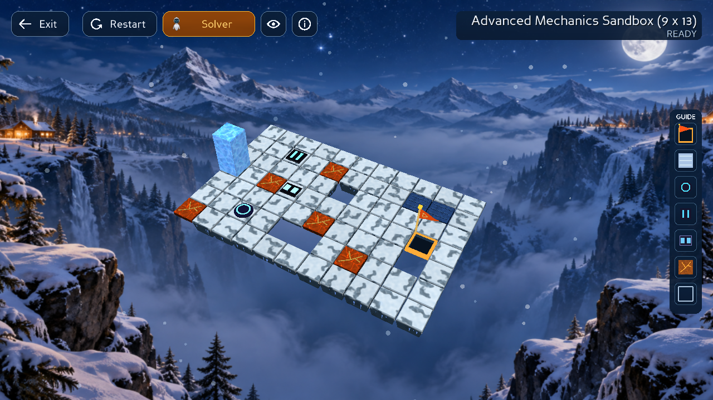
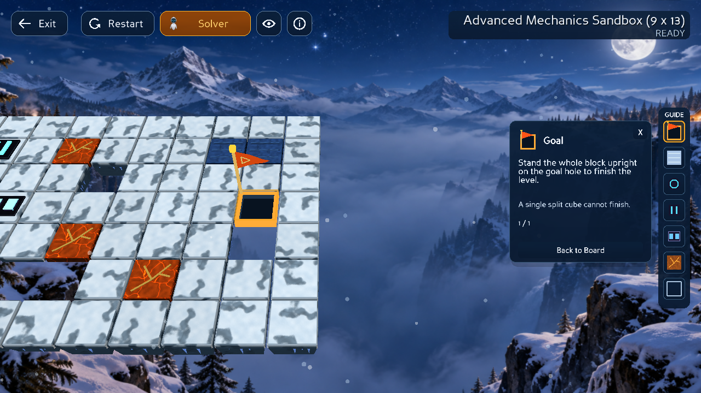
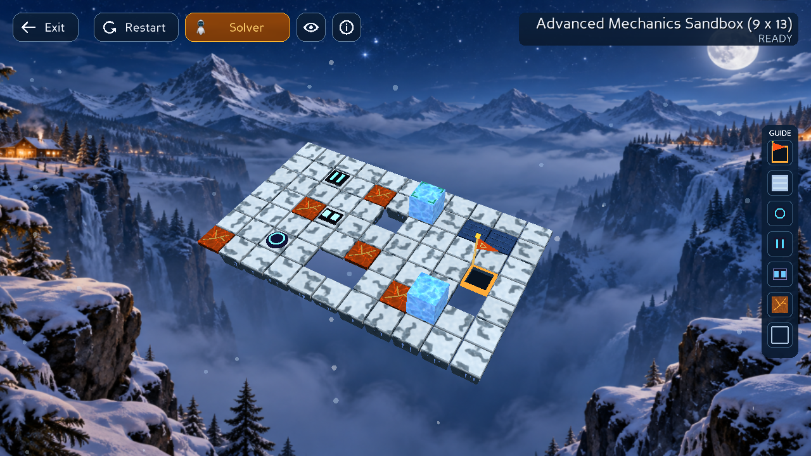
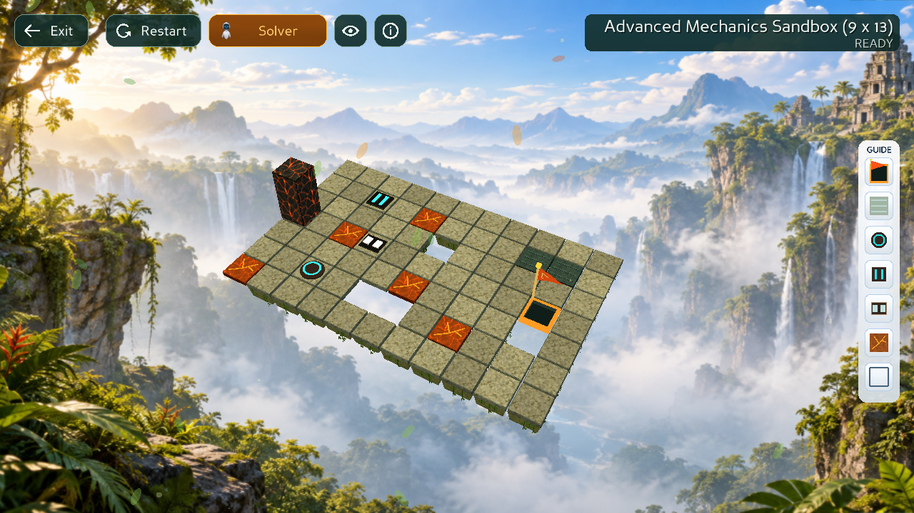

# GUI renderer merge into latest team-code

Integration date: 2026-10-28.

- Target: `feat/team-code/phase2-game-gui`, `7a077702aa3197c5f9136a9ba60324418dc71367`.
- Feature: `feat/phuoc/gui-renderer-upgrade`, `06880f7c99c6474a5be7afc2562a2d4d11260cf3`.
- Merge preserves both histories. No Core/solver rules were changed during conflict resolution.

## Resolution

| File | Decision |
| --- | --- |
| `src/gui/camera.py` | Keep team's free zoom and far-plane floor plus Guide's presentation capture/restore and user-input callback. Automatic Follow reframing does not cancel Guide ownership. |
| `src/gui/camera_views.py` | Keep orbit/scroll/reset and drag-versus-click behavior. Suspend Follow and pending zoom easing during Guide focus; fresh drag/scroll takes over the displayed focus centre and distance without snapping to the old centre. C resets that manual view. |
| `src/gui/visual_materials.py` | Keep team's ice registry, height/detail shader inputs and dark block mapping. Keep Phuoc's Snow Temple 2.0 floor shader, textures and opaque fallback. The other conflict was the material-data docstring. |

Dark whole blocks and split cubes use **ice**; Light/Jungle uses **magma**. Snow flooring remains independent of block material. Latest team HUD labels, Solver-only metrics panel, intro, bloom and mouse-release handling are retained. About, current-state solving, Guide lookup/focus, single-page tutorial and split/merge VFX arrive from the feature history.

## Baseline and automated regression

The immutable latest-team archive ran **522 tests with one failure**: `test_small_window_keeps_level_progress_when_title_is_elided`. That assertion required `(11/18)`, while team's `display_level_label()` deliberately removes the progress suffix. Updated that test to require the normalized/elided title and preservation of the original model label. The existing text-fit/elision coverage remains.

The final merged tree ran **604 tests, zero failures/errors**:

```bash
.venv/bin/python -B -m unittest discover -s tests -q
```

Added integration checks for orbit/zoom + exact Guide Back restore, preserved far plane, Guide ownership with pending zoom, wheel takeover without a camera jump, reset, and simultaneous Snow floor + ice whole/cube materials. Existing camera geometry, gameplay, six-solver, animation and lifecycle tests remain enabled.

## Actual Panda3D runtime

Used real GLX GraphicsWindows under Xvfb and X11 XTest mouse/keyboard events. Screenshots below are captured from the live framebuffer, not fabricated UI. Both material shaders compiled in the real graphics context. All **25 runtime check groups passed**:

- `tools.mechanics_focus_smoke` (11): seven mechanics, target cycling, Back/X, absent/inactive mechanisms, both themes, four sizes, busy gating, six spawned solver replays.
- `tools.merged_camera_smoke` (4): both themes × Iso/Top/Follow, native drag/scroll, exact Back restoration, wheel/drag ownership transfer, C reset, no accidental gameplay moves, natural intro completion, actual ice/magma bindings, Solver-panel metrics visibility.
- `tools.split_teleport_smoke` (5): both themes, actual split endpoints and continued cube control, Pause/Step, cancellation, three camera modes/replay speeds.
- `tools.merge_teleport_smoke` (5): both themes × horizontal/vertical fusion, Pause/Step/Goal, cancellation, three camera modes/replay speeds.

Example reproduction (substitute the other tool module names as needed):

```bash
LP_NUM_THREADS=2 xvfb-run -a -s '-screen 0 2200x1400x24 +extension GLX' \
  .venv/bin/python -B -m tools.merged_camera_smoke --output /tmp/bloxorz-merged-ui/camera
```

Evidence: [baseline](evidence/team-gui-merge/team-baseline.txt), [604-test log](evidence/team-gui-merge/regression.txt), [Guide](evidence/team-gui-merge/guide-report.json), [camera](evidence/team-gui-merge/camera-report.json), [split](evidence/team-gui-merge/split-report.json), [merge](evidence/team-gui-merge/merge-report.json).






## Limits

Runtime validation uses software OpenGL/Xvfb on Linux; physical GPU/other-OS performance is not established by these results. Full raw UI frames and extra screenshots are in `/tmp/bloxorz-merged-ui`; selected evidence and machine-readable reports are saved above. This integration does not change tile mechanics, solver costs or metrics definitions.
